# Who does what: every role, screen by screen

This is the reference for how the utility system is meant to be used, role by role, written from the user's chair.
Use it to train staff, to check a new version before trusting it (the checklist at the end), and to settle "should I
be able to do this?" questions. Every button name, message and email below is the real one, and the pictures are taken from the program itself
with demo data (`npm run screenshots` retakes them after a change).

The rule throughout: money moves only when two different people agree, every change is written to a log that cannot
be edited, and nobody sees more than their job needs.

Contents: [Everyone](#everyone-signing-in-and-getting-around) · [Resident](#resident-a-customer) ·
[Meter reader](#meter-reader-field-crew) · [Billing clerk](#billing-clerk) · [Cashier](#cashier) ·
[Customer service](#customer-service) · [Approver](#approver) · [City administrator](#city-administrator) ·
[Site administrator](#site-administrator-the-person-who-runs-the-server) · [Auditor](#auditor) ·
[Emails the system sends](#every-email-the-system-sends) · [Money rules](#the-money-rules-in-one-place) ·
[Test checklist](#manual-test-checklist-run-after-any-update-on-the-demo-first)

---

## Everyone: signing in and getting around

### The sign-in page
1. Open the site. The top bar shows the city's logo and name with "Utilities" under it. If the city has demo mode
   on, a yellow bar says "Demo site. This is not the official ... utility system. No real bills or payments."
2. The page says **Sign in**, "Pay your bill, see your usage, and get help, all in one place." There is one box,
   "Your email address", with the hint "We'll email you a code. There is no password to remember." Press
   **Email me a code**.
   - A half-typed address gets "Please type your full email address, like name@example.com."
   - The button reads "Sending..." for a moment, then the page changes to **Check your email**: "We sent a code to
     you@example.com. It can take a minute. Check your spam or junk folder if you do not see it." The page says the
     same thing whether or not the address is known, so nobody can use it to find out who has an account.
3. The email is titled "City of Osceola utilities: your code" and holds an 8-digit number. Type it in "Type the 8
   numbers from the email" and press **Sign in**. There is also "Use a different email or get a new code".
   - Fewer than 8 digits: "The code has 8 numbers. Please check the email and try again."
   - A wrong code gets a plain message and the box is selected again for another try. A code works for 10 minutes
     and 5 tries. One address can ask for 3 codes in 10 minutes; after that, "Too many tries. Please wait a
     minute." A code that has already been used is refused.
4. A session lasts 12 hours. Signing out (the **Sign out** link in the top bar) ends it on the server, so the Back
   button lands on the sign-in page, not the old screen. If the server ever drops a session, the next click shows
   "You were signed out to keep your account safe. Please sign in again."

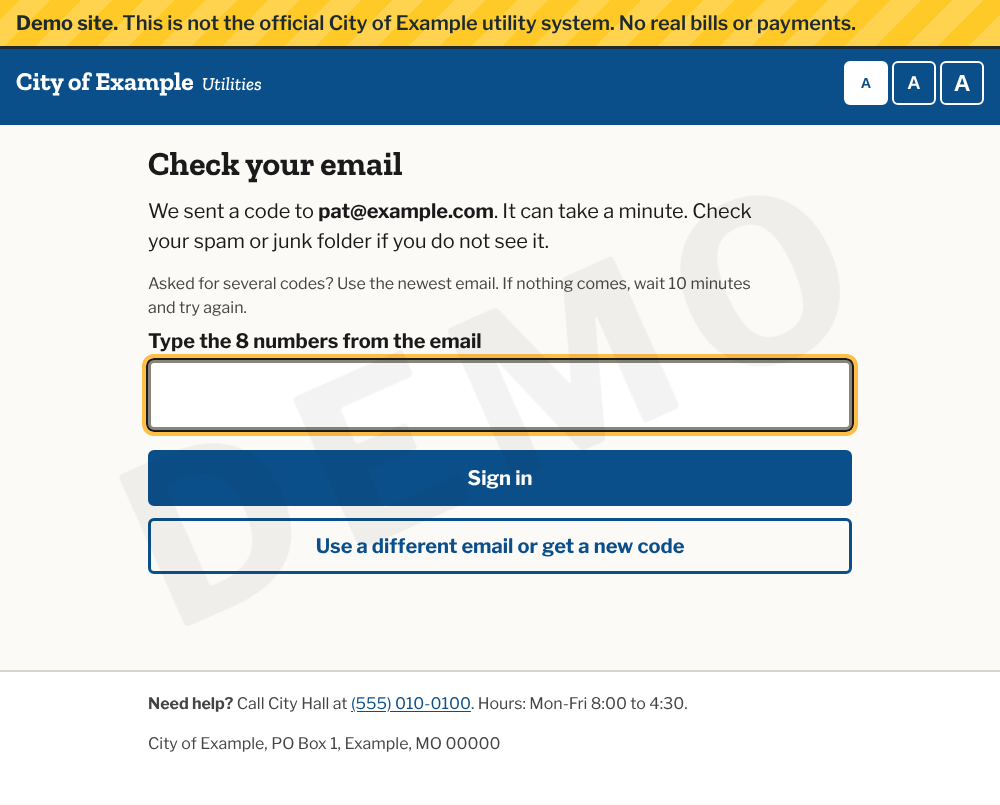

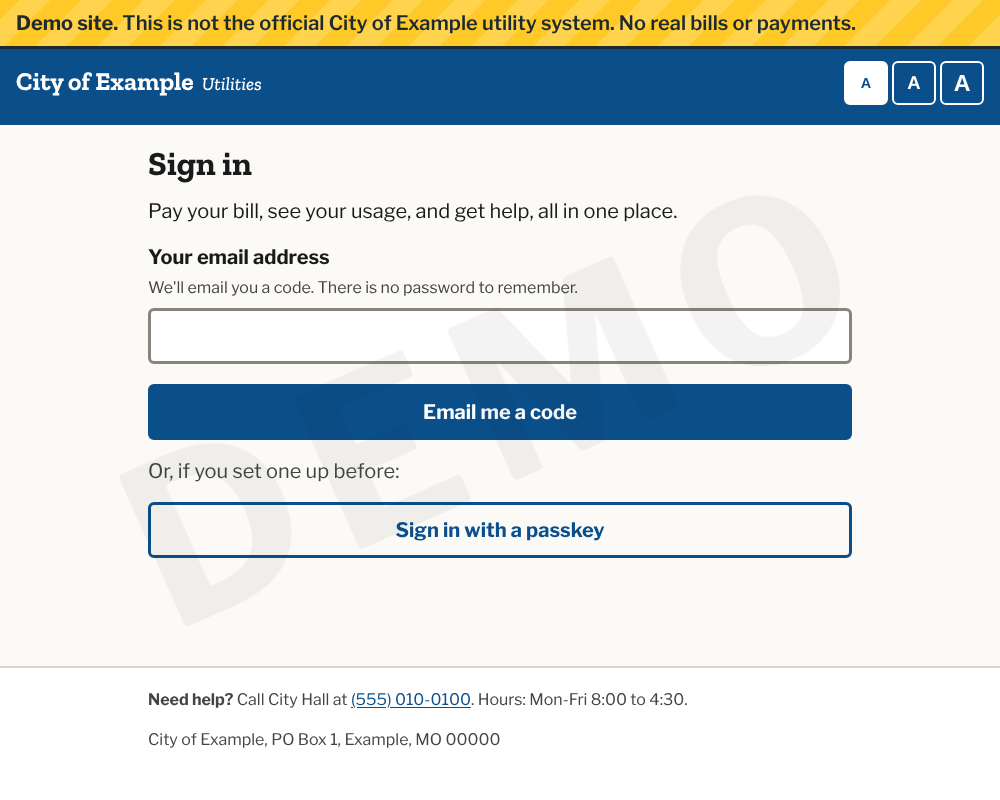

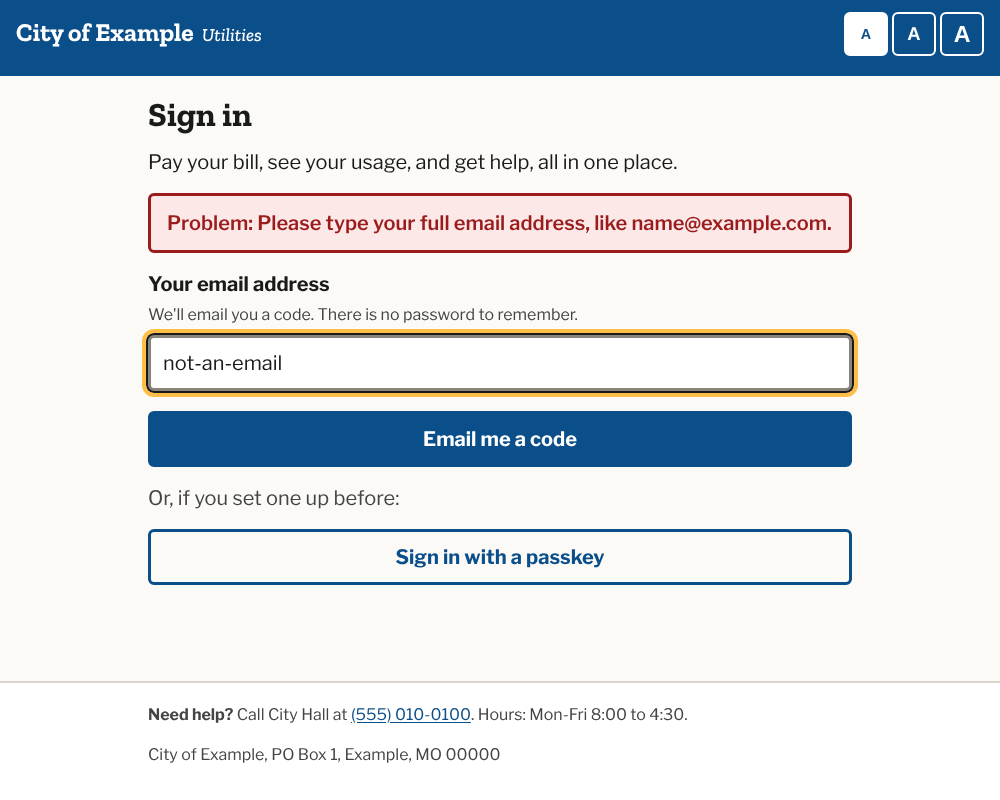

**Passkeys.** Under the sign-in form, "Or, if you set one up before:" **Sign in with a passkey** uses the
fingerprint, face or PIN on the device. Cancelling it says "That was cancelled. You can use an emailed code
instead." To set one up, anyone signed in presses **My sign-in options** in the footer. That page, **My sign-in**,
has a "Name for this device" box ("For example 'My phone'. Only you see this.") and **Add a passkey to this
device**; each saved passkey shows when it was added and last used, with a **Remove** button that asks "Remove this
passkey? You can still sign in with an emailed code." The page ends "An emailed code always works too, so you can
never be locked out."

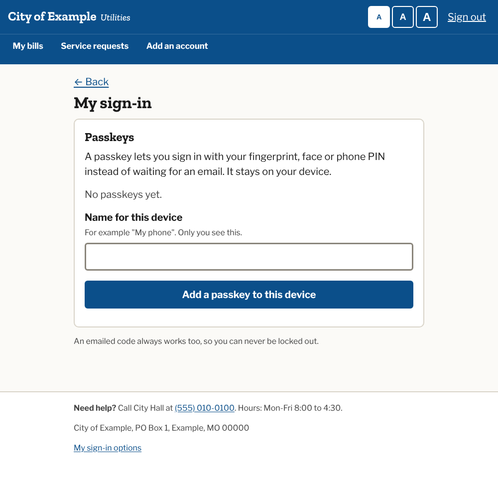

**Single sign-on.** If the city has connected its own sign-in system, a **Sign in with your ...** button appears
too. A failed attempt shows "That sign-in did not work. Your account may not be set up yet. You can still use an
emailed code."

### Getting around
- Tabs under the top bar list only what the signed-in person can open. A resident sees **My bills**, **Service
  requests**, **Add an account**. A meter reader sees **Meter reading**. Office staff see **Staff home** and the
  tabs their roles allow. The tab bar is hidden when there is only one tab.
- A person with several roles sees every tab those roles give. A staff member who is also a customer sees the
  resident tabs too, and on those pages can only act on accounts linked to them, like any other resident.
- Every page has **A** / **A** / **A** buttons in the top bar for smaller or larger text; the choice is remembered
  on that device.
- The footer on every page says "Need help? Call City Hall at (phone)." with the office hours and the city's
  address, all taken from City settings.
- Errors are plain sentences in a red box next to the thing that failed. Something unexpected shows "Something went
  wrong. Please try again, or call City Hall." A lost connection shows "We can't reach the city's computer right
  now. Check your internet and try again."

### The safety check
Risky actions (approving, changing roles or settings, new rates, new link codes, reversing a ledger entry,
collecting autopay, turning a person off) open a small window titled **A quick safety check**: "For your safety we
sent a code to you@city.gov. Type it below." A fresh 8-digit code is emailed; type it and press **Confirm**, or
**Cancel** (which shows "That action needs a quick safety check first." and changes nothing). Once passed, the check
lasts for the number of minutes the city set (1 to 30, usually 10), so a run of approvals asks only once.

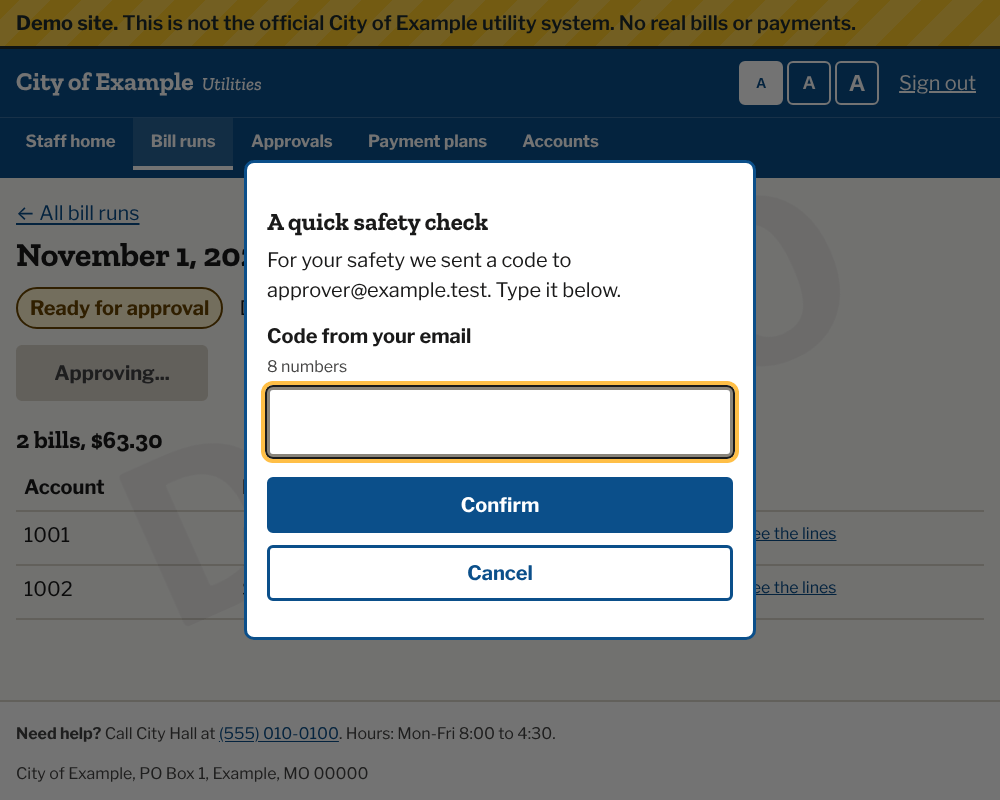

---

## Resident (a customer)

**Tabs:** My bills, Service requests, Add an account.

### First visit: connecting the account
1. Sign in with any email address. A new address is simply a new person with nothing linked yet, and the first
   page is **Welcome**: "Let's connect your utility account so you can see and pay your bill. It takes about a
   minute. You will need a recent paper bill." with a **Connect my account** button and the line "New in town or
   moving? Ask for new service."
2. **Connect your account** asks for two things from the paper bill or the city's letter: "Account number"
   ("Numbers and letters near the top of your bill") and "Link code" ("Looks like ABCDE-12345. Capital letters or
   small ones both work."). Press **Connect my account**. Under the form: "Don't have a code? Call City Hall and we
   will help you. This keeps your account private."
   - Either box empty: "Please fill in both boxes."
   - A wrong code gets a plain message. Five wrong codes lock that person out of linking for an hour. City Hall can
     make a new code (it is printed on the next bill or read out at the counter).
3. On success the page jumps to **Your utility bills**. Another account (a rental, a shop) is added the same way
   from the **Add an account** tab or the "add another account" link at the bottom.

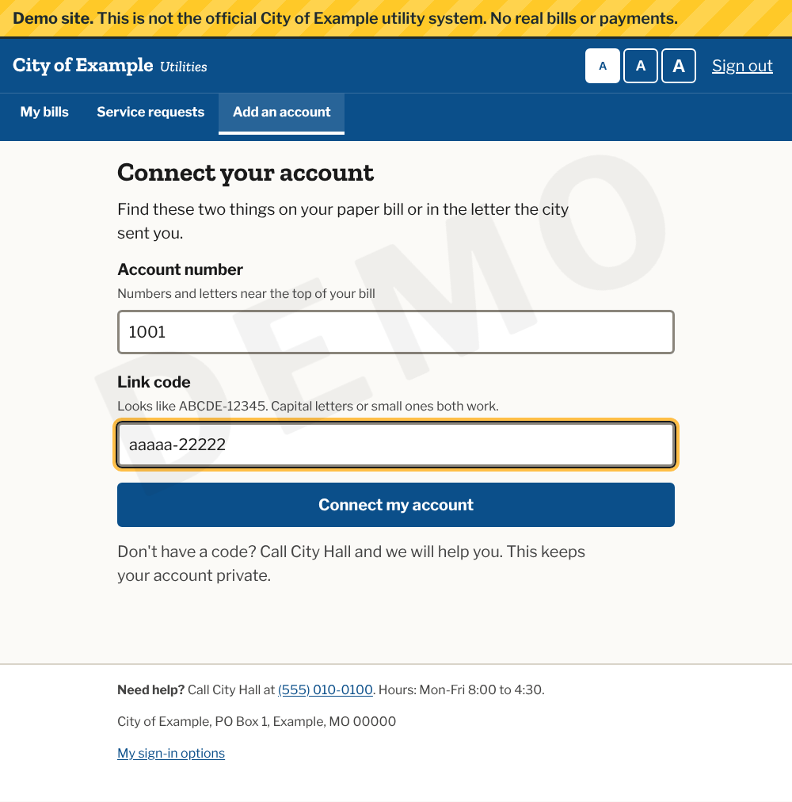

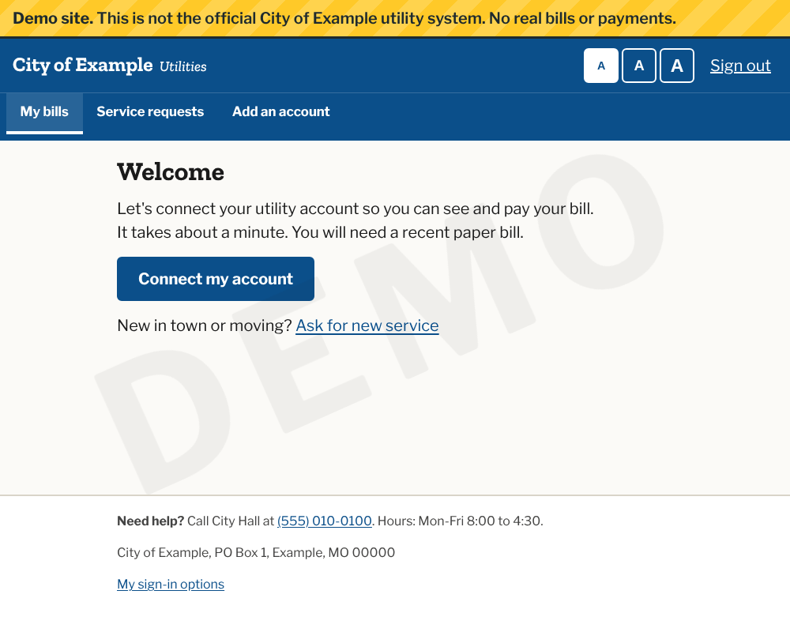

### Your utility bills (the home page)
Each linked account is a card: the service address as the heading, "Account 1001" under it, then "You owe" (or
"Your credit", or "Your balance") and the amount in large type. An account with nothing due shows "✓ You're all
paid up" (or "✓ You have a credit"). Buttons: **Pay $84.20 now** (only when something is owed) and **See my bills
and history**. At the bottom: "Start, stop or move my service or add another account".

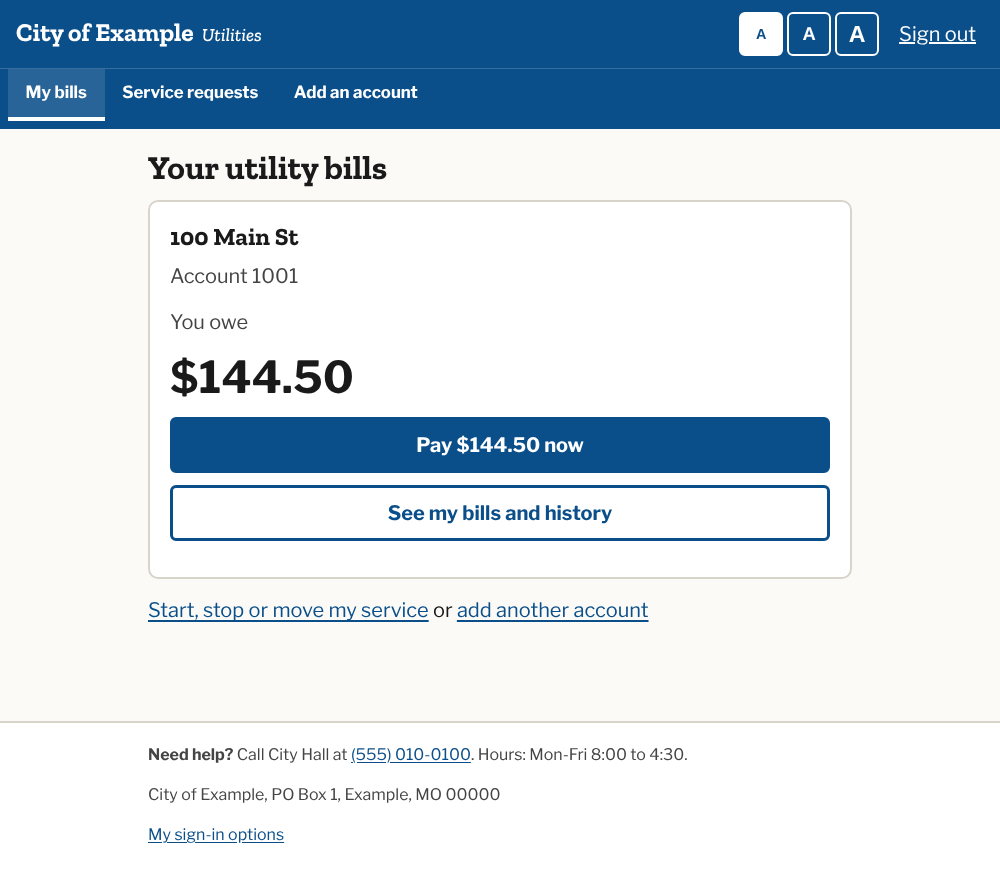

### See my bills and history (the account page)
- The heading is the address, then "Account 1001", then a card with the balance and **Pay ... now** or "✓ Nothing
  due".
- **Your bills**: one entry per bill with the month ("October 2026"), the amount, "Due November 15, 2026", a status
  of **✓ Paid**, **Partly paid. $12.00 left** or **Not paid yet**, and an "Open this bill" link. Payments are applied
  to the newest bill first when working out which bills are paid.
- **Payment plan** card (see below).
- **Recent activity**: every entry on the account with a plain name: New bill, Payment, Adjustment by City Hall,
  Late charge, Correction, Charge, Refund; the date; and the memo City Hall wrote (for example "Online payment
  (card), plus $0.21 fee paid"). Credits show in green.
- **Paper bills** card: a checkbox "Stop mailing me a paper bill" with "You'll still see every bill here, and we
  will email you when a new one is ready. You can turn paper back on anytime." It saves as soon as it is ticked
  ("Paper bills turned off" is read out to screen readers).
- **Autopay** card (see below).

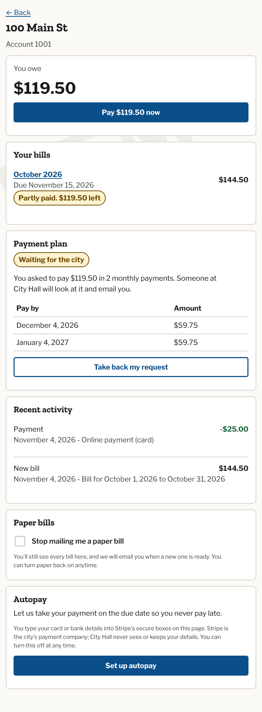

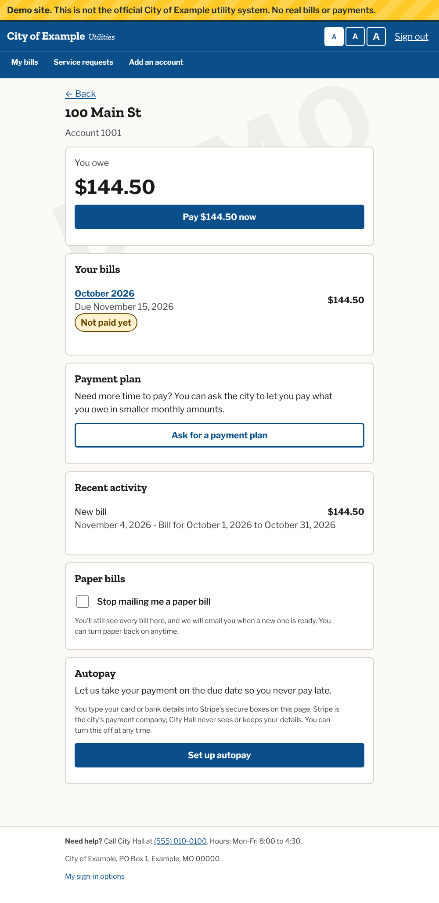

### Open a bill
The page **Bill for October 2026** shows "Due November 15, 2026", the paid status, and a table "What you were
charged for": each line's description, the units used with their name ("4,200 gallons used"), the meter number
when the city bills per meter, "(2 at $5.00 each)" for quantities, and the total. Buttons: **Pay my whole balance:
$84.20** and **Something looks wrong**.

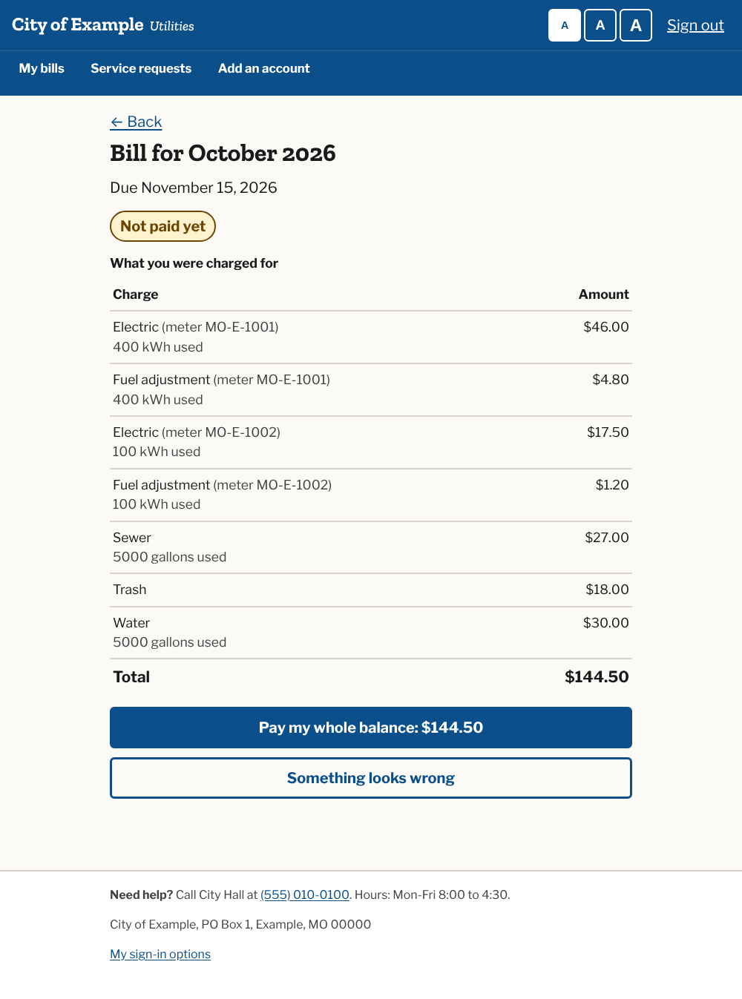

**Something looks wrong** opens a box "What looks wrong?" ("For example: 'My water use seems too high.' A clerk will
look at it and get back to you.") with **Send to City Hall**. After sending: "Thank you. City Hall got your message
and will contact you. You don't need to pay the part in question until it is checked, but please call us if the due
date is close." The question goes to the staff **Bill questions** queue. Only one open question per bill is
allowed; a second attempt is refused with a plain message. The answer is not emailed; staff call or write to the
customer, and the entry stays on the bill.

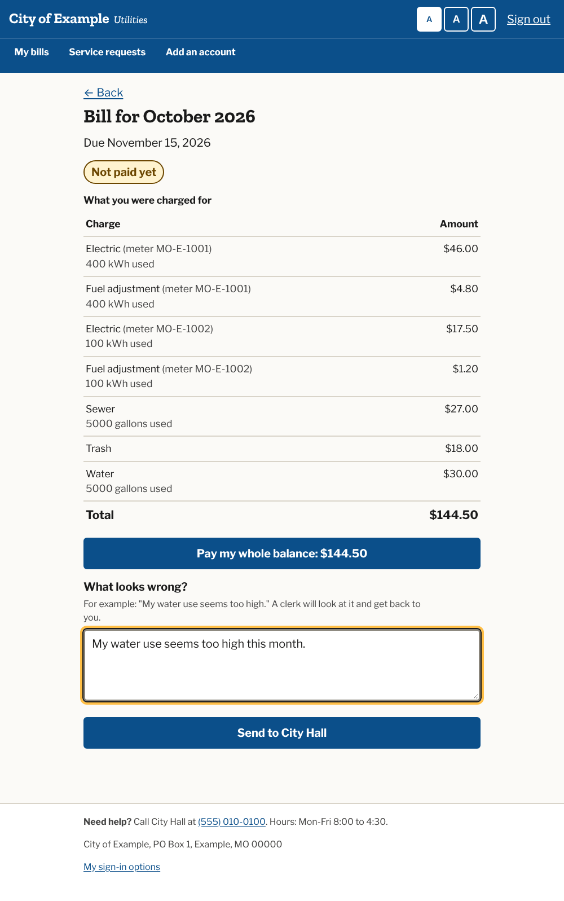

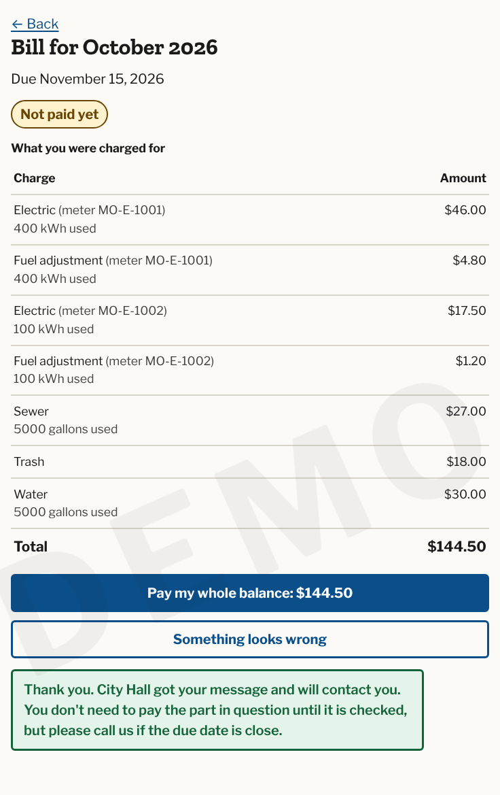

### Pay your bill
1. Press any **Pay ... now** button. The page **Pay your bill** shows the address and the choices:
   - **Pay my payment plan amount: $40.00** (only when an approved plan has a payment coming up; chosen by default)
   - **Pay everything I owe: $84.20** (chosen by default otherwise)
   - **Pay a different amount**, which reveals "Amount in dollars" ("For example 25.00. The smallest payment is
     $1.00."). "You can pay part of what you owe. Whatever is left stays on your account."
   - An account with nothing owed can still pay ahead with "Pay a different amount".
   - "Please type an amount like 25.00." for a bad number; "You can pay between $1.00 and $10,000.00 at a time."
     outside the limits.
   The hint under the choices says: "Next, you type your card or bank account right here. Those details go straight
   to Stripe, the city's payment company. The city never sees or stores them." Press **Continue**.
2. The card **Paying $84.20 on your bill** appears ("Loading the secure payment form..." for a second). If the city
   passes on a fee, a yellow notice says so up front (for example that credit card payments carry a fee and debit
   cards do not). Stripe's own boxes let the customer type a card or choose "US bank account". Buttons: **Review my
   payment** and **Change the amount** (which goes back to step 1).
3. **Review my payment** checks the card or bank with Stripe and shows a box **Check your payment**: "Paying with:
   Visa credit card ending 4242", then a small table: Bill payment $84.20, the fee line when one applies (for
   example "Credit card fee $2.74"), and **Total charged**. Under it: "The fee covers what the payment company
   charges the city. Only $84.20 goes toward your bill." When no fee applies it says so (debit cards never pay a
   credit-card fee). Changing the card or bank clears the review and asks to review again, so the total shown is
   always for the method that will be charged. Problems with the card details show Stripe's own message, such as
   "Your card number is incomplete."
4. Press **Pay $86.94**. The button reads "Paying..." and then:
   - **Thank you**: "✓ Your payment went through and is on your account." (or "It can take a minute to show on your
     account."), "You will get a receipt by email from Stripe, the city's payment company." and **Back to my
     bills**. The account shows the payment at once, and the bill flips to Paid or Partly paid.
   - A declined card: "The card or bank turned the payment down. No money was taken." stays on the same page with
     the review cleared, so the customer can type another card and review again. One payment, one charge; a decline
     never leaves a fee behind.
   - A bank account: **Thank you**, "✓ Your bank payment has started. Bank payments take a few business days to
     finish, and your account will show it then." The payment posts when the bank confirms it.
   - A card that needs the bank's extra check (3-D Secure) opens that check in place and then continues.
   - Twenty payment starts in an hour is the limit; after that, "Too many tries. Please wait a minute."
5. Only the bill amount is credited to the account. The fee is recorded on the payment, not on the balance, and
   appears in the memo ("plus $2.74 fee paid").

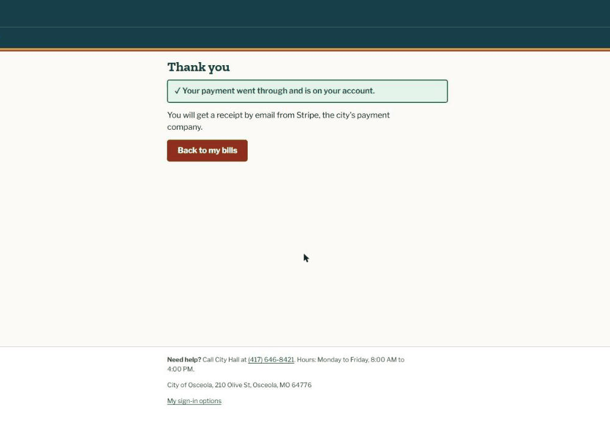

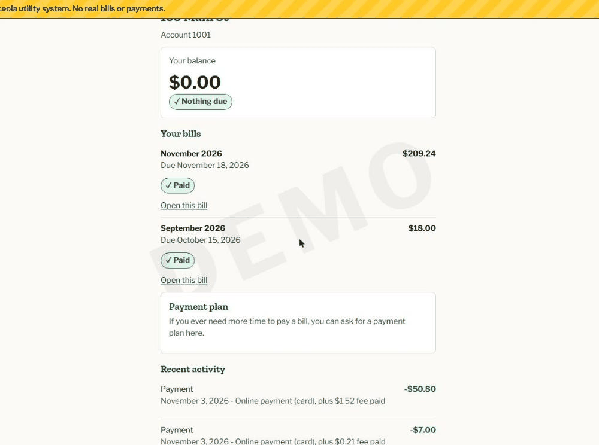

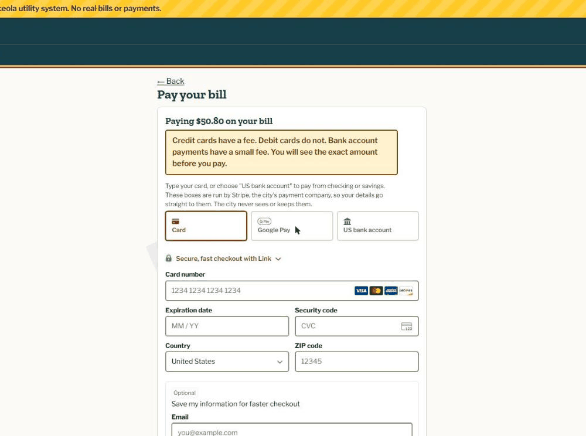

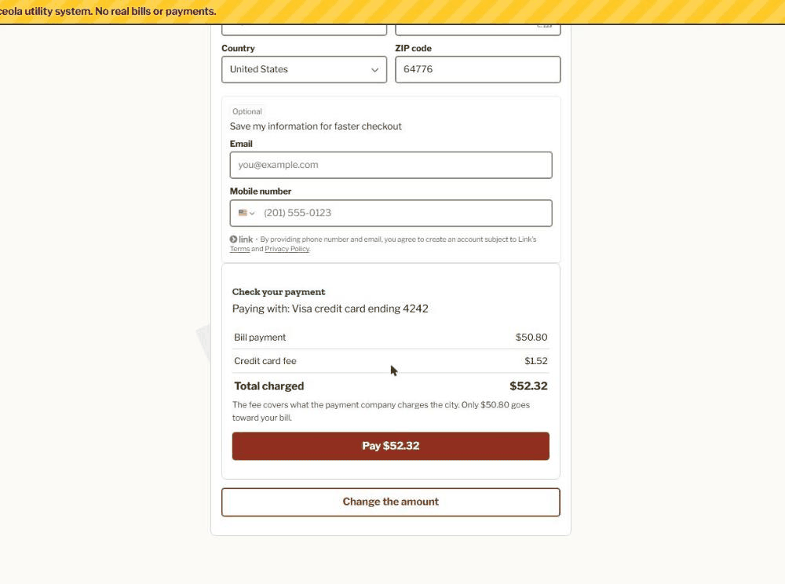

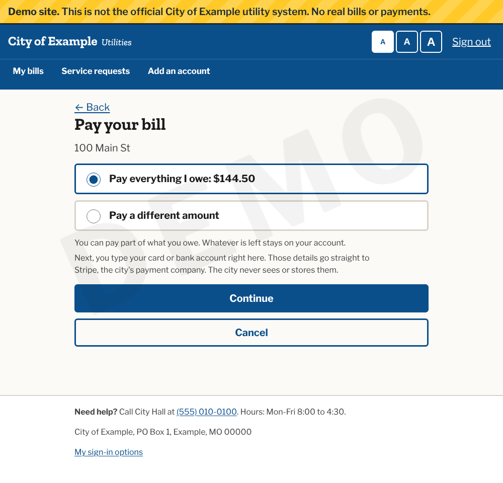

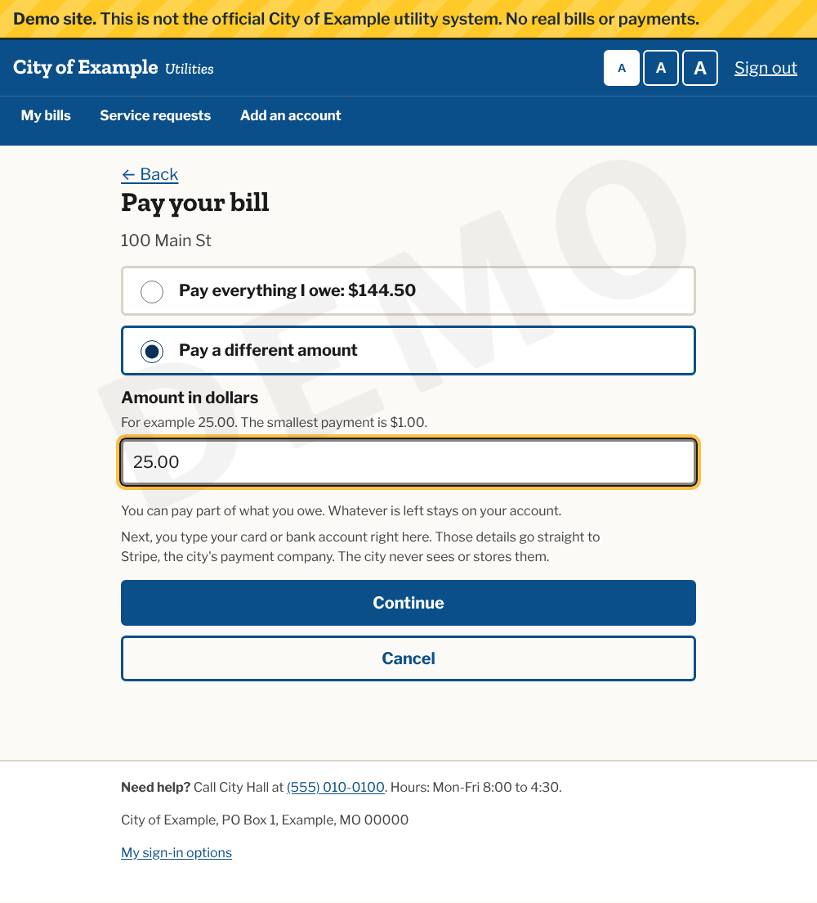

### Autopay
- The **Autopay** card on the account page says "Let us take your payment on the due date so you never pay late."
  with the note that details go into Stripe's boxes and the city never sees them. Press **Set up autopay**: Stripe's
  boxes appear with "Type the card or bank account to use. Stripe keeps it, not the city." and **Save and turn on
  autopay**. A refused card shows Stripe's message and nothing is saved.
- Once on, the card reads "On. We take your payment on the due date from: Visa card ending 4242." and the button
  becomes **Turn autopay off**, which asks "Turn autopay off? We will stop taking your payment automatically. You
  will need to pay each bill yourself."
- When a bill is due, the city collects it (a clerk presses a button, or a nightly job runs). Each bill is
  collected at most once, and never more than what is owed. If the charge fails the customer gets the email "Your
  autopay could not be collected" and pays by hand; the city does not retry. Ten autopay set-ups an hour is the
  limit.

### Ask for a payment plan
- The **Payment plan** card on the account page says "Need more time to pay? You can ask the city to let you pay
  what you owe in smaller monthly amounts." with **Ask for a payment plan**. (With less than $2.00 owed it only says
  "If you ever need more time to pay a bill, you can ask for a payment plan here.")
- The form: "You owe $240.00. Choose how many monthly payments you would like. City Hall decides, and will email
  you." A list such as "3 payments of about $80.00" (2 to 12 payments, only choices that keep each payment at least
  $1.00), and "Why do you need more time?" ("A sentence or two is fine. For example: 'Medical bills this month.'").
  Press **Send my request to the city**. An empty reason: "Please tell us a little about why you need more time."
- While waiting, the card shows **Waiting for the city**, "You asked to pay $240.00 in 3 monthly payments. Someone
  at City Hall will look at it and email you.", the proposed dates and amounts, and **Take back my request** ("The
  city will not look at it. You can ask again later.").
- Approved: "✓ Your plan is approved and you are keeping up with it.", "Next payment: $80.00 by December 1, 2026."
  and the schedule with "(next)" marked, "Any payment you make counts toward the plan. New bills are still due on
  their own dates." and **Pay $80.00 now**. The pay page then offers the plan amount as the first choice.
- Behind: a yellow "You are behind on your plan. Please pay $80.00 as soon as you can, or call City Hall." While the
  customer keeps up, the bills in the plan get no late charge and the plan amount is not counted toward a shutoff;
  falling behind turns both back on. The customer cannot cancel an approved plan; they call the city.
- Declined: "The city could not approve your last request." followed by the note the approver wrote, and the
  **Ask for a payment plan** button is back.
- The decision arrives by email either way: "Your payment plan was approved" or "About your payment plan request".

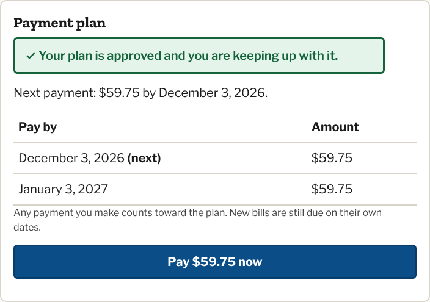

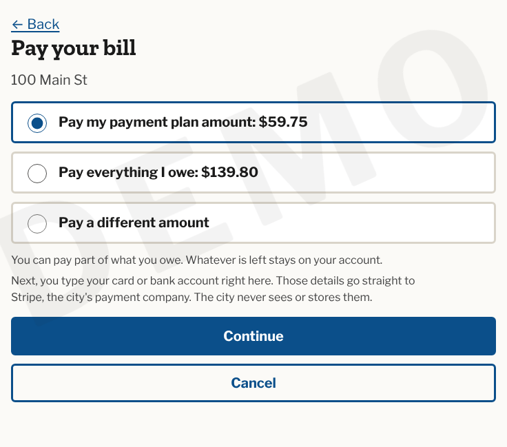

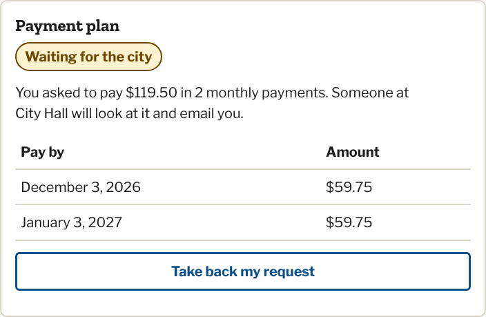

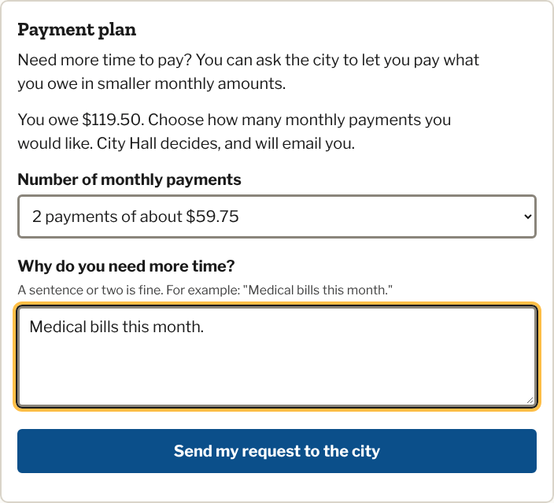

### Service requests
- The **Service requests** tab: "Need to start, stop or move your service? Pick one below. City Hall will take it
  from there." Under **Make a new request**: Start new service ("I am new in town, or moving to an address in
  town."), Stop service (disconnect), Move out ("I am leaving. Send me a final bill."), Move to a new address,
  Report a leak ("Water is leaking at a meter, line or street.").
- Each form asks only what that request needs: name, address and start date for new service (no account needed);
  which account, last day and an optional note for a stop; moving day and "Where should we mail your final bill?"
  for a move out; the new address and moving day for a transfer; "Where is the leak?" for a leak, with the warning
  "If water is flooding a home or street, call City Hall now at (phone)." Every form has **Send my request** and
  **Cancel**. Someone with no linked account who picks a stop, move or leak is told "First connect your account, so
  we know which one you mean."
- After sending: **Request sent**, "Thank you. City Hall has your request. We will update the status on this site.
  You do not need to do anything else."
- **Your requests** lists each with a status: **Received**, **Scheduled**, **✓ Done** or **! Could not be done**,
  the account and date, and "From City Hall:" followed by any note staff wrote. A request never changes a bill by
  itself. At most three open leak reports per person.

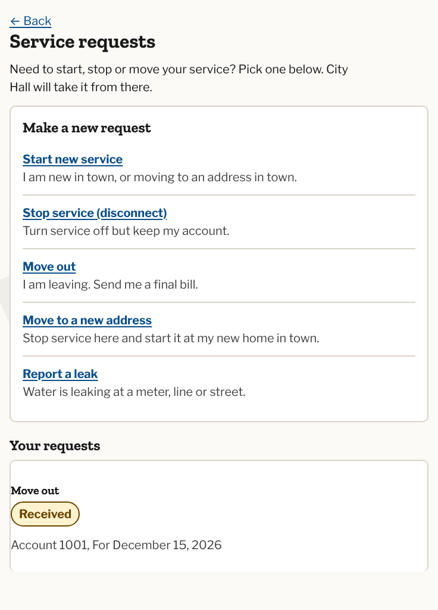

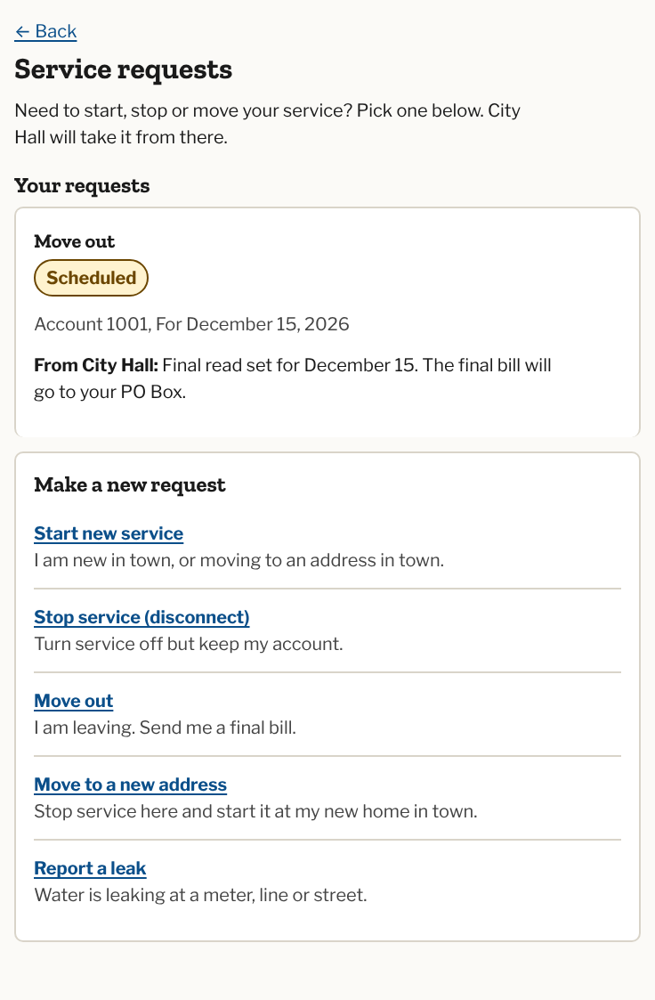

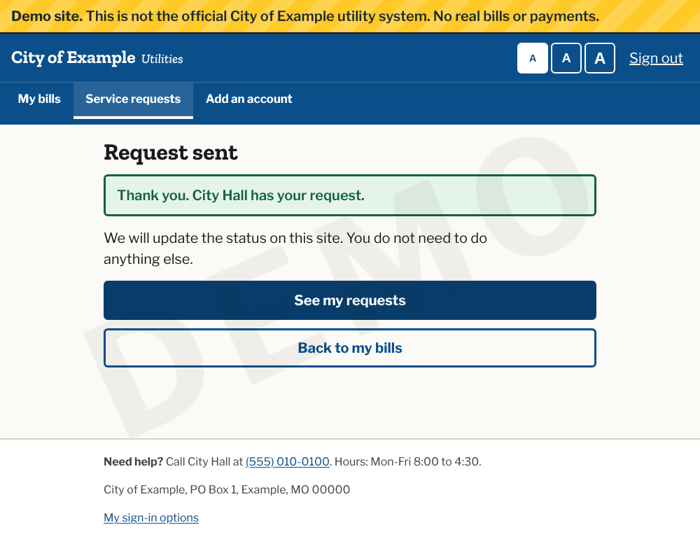

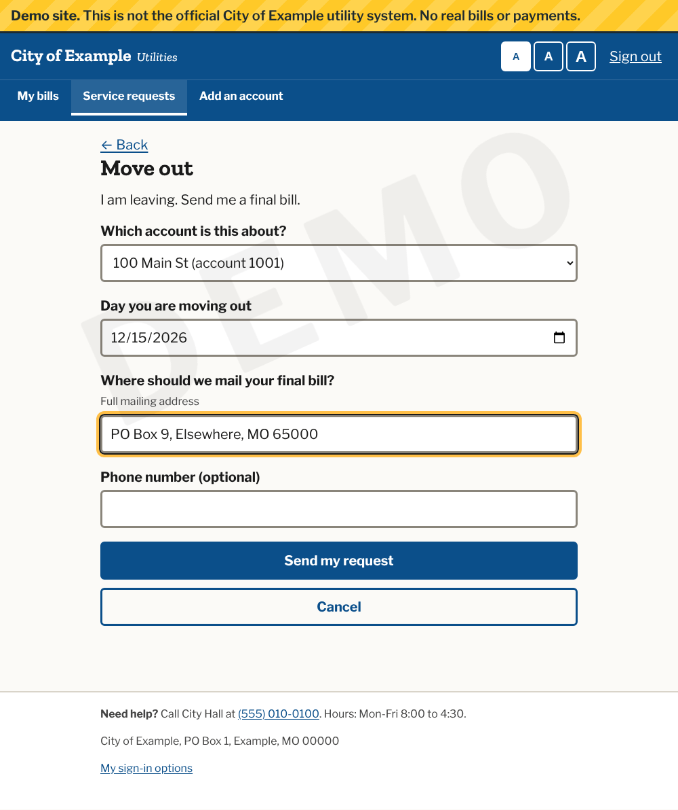

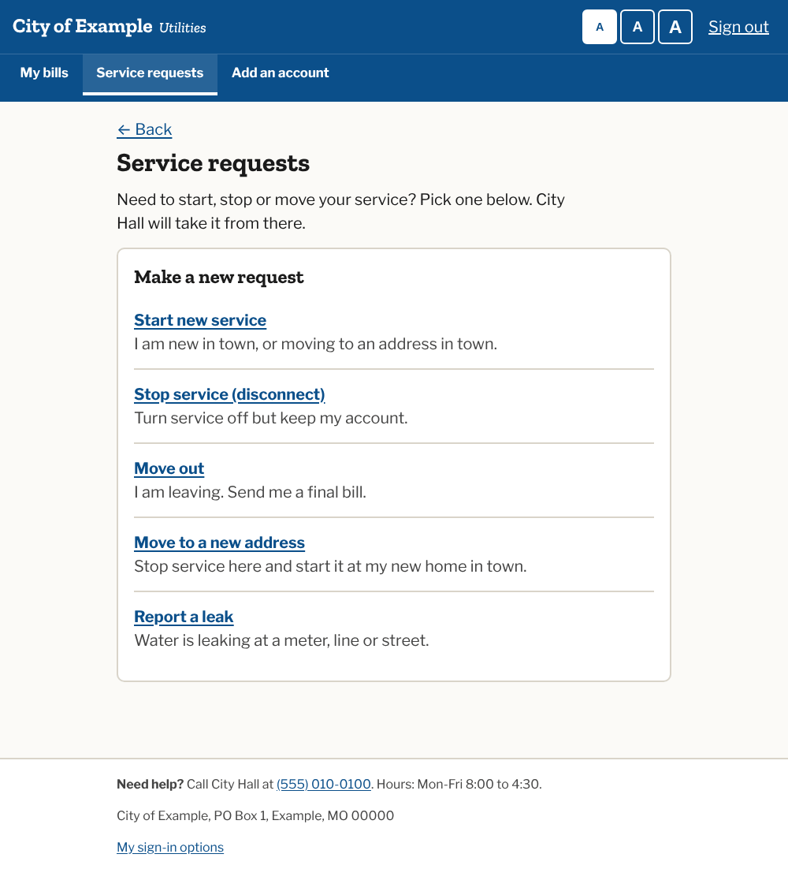

### A resident must NOT be able to
- See, pay, or set up autopay or a plan on an account that is not linked to them. Typing another account's address
  into the browser bar shows "We couldn't find that."
- Change anything on the account other than the paper-bill switch.
- Reach any staff page or staff data; the staff addresses answer "You don't have permission to do that."
- Cancel an approved plan, re-open a declined one, change its terms, mark a payment paid, or point autopay at a
  card they did not save. The database refuses these even if the app were bypassed.

---

## Meter reader (field crew)

**Tabs:** Meter reading only. Signing in lands straight on it. Works on a phone, with or without signal.

### Take readings
1. **Meter readings** lists every meter: the address in bold, "Water meter 44512" under it, and "Last: 14500" on the
   right. No names, balances or account numbers, ever. "Find a meter" filters as you type part of an address or
   meter number. Without signal the list saved on the phone is shown with "Showing the list saved on this phone.
   No signal right now."
2. Tap a meter. The page is headed with the address, shows "Water meter 44512", "Last reading: 14500", and asks
   "What does the meter say now?" ("Numbers only") with an optional "Note (only if needed)" ("For example: dog in
   yard, meter buried"). **Save this reading** or **Cancel**.
   - Letters in the box: "Please type just the numbers on the meter."
   - A number lower than last time opens **Lower than last time**: "The last reading was 14500 and you typed 1450.
     Is that right?" with **Yes, that is what it says** / **No, let me fix it**. A rollover or a swapped meter is
     accepted; the office sorts out the real usage.
   - A very large jump opens **That is a big jump** with the same two choices.
3. The reading is saved on the phone first, then sent. The list shows **Saved** (not sent yet), **✓ Sent**, or
   **! Needs a look** if the office refused it. A yellow bar counts "3 readings are saved on this phone and not sent
   yet." and **Send saved readings now** sends them; sending twice never makes a duplicate. With no signal the page
   says "Still no signal. Your readings are safe on this phone." and sends on its own when signal returns.
4. A reading far above normal is flagged for the office automatically; the reader does nothing extra.

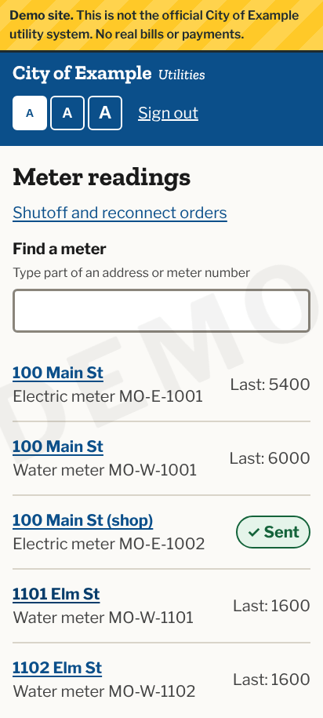

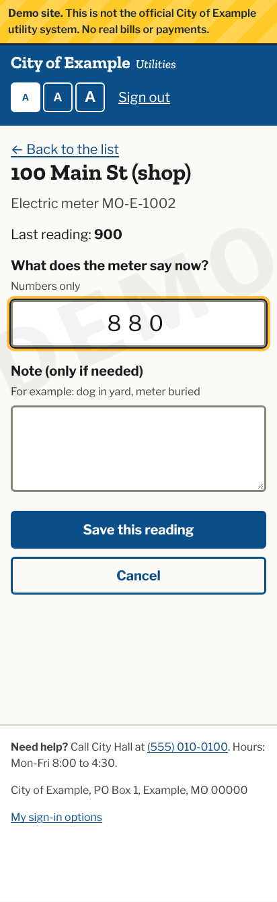

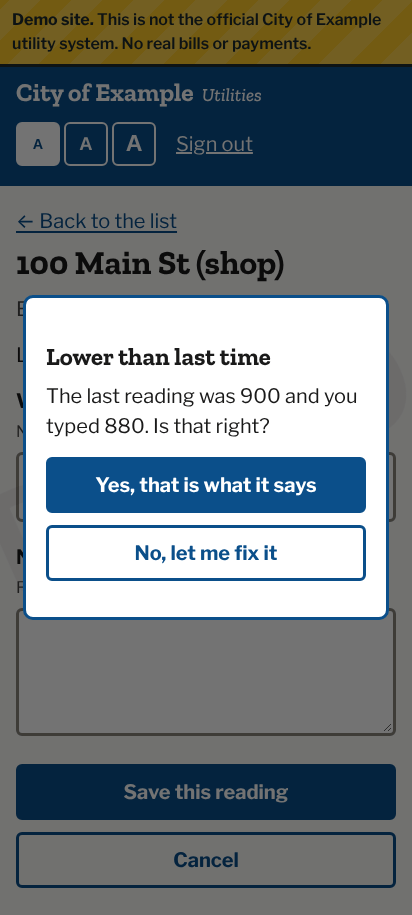

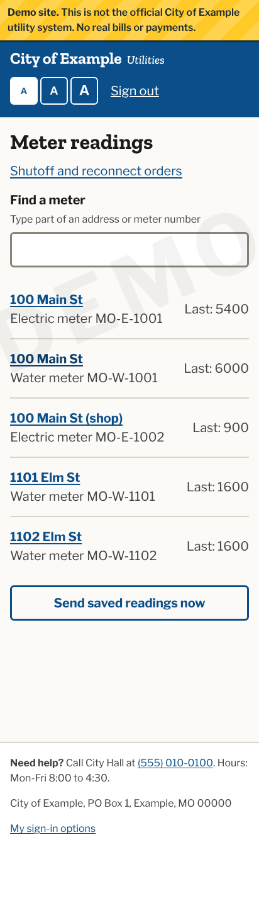

### Shutoff and reconnect orders
1. The link "Shutoff and reconnect orders" at the top of the list opens **Shutoffs and reconnects**. Each order is a
   card: "Shut off: 12 Elm St" or "Turn back on: 12 Elm St", with the clerk's note if there is one. No names or
   amounts.
2. Do the work, type anything the office should know in "Anything to tell the office? (optional)" ("Meter locked
   off 4:15 PM, tag on door"), and press **Mark done**. A confirmation asks "Is this done? Service is shut off at
   12 Elm St." with **Yes, it is done** / **Not yet**. The order leaves the list. With nothing waiting the page says
   "✓ No shutoff or reconnect orders right now."

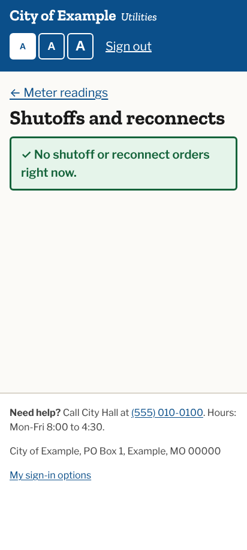

### A meter reader must NOT be able to
- See any customer name, balance, bill, account number or payment, anywhere.
- Review or accept a reading, including their own.
- Reach any staff, admin or resident page.

---

## Billing clerk

**Tabs:** Staff home, Review readings, Bill runs, Approvals, Accounts, Administration.

**Staff home** is a row of cards with a count and a button each: "N readings to check" (**Review readings**),
"N requests waiting for approval" (**See approvals**), "N payment plan requests" (**See payment plans**), "N bill
questions from residents" (**See questions**), "N service requests to handle" (**See requests**), "N shutoff and
reconnect orders" (**See orders**), "Monthly billing" (**Open bill runs**), "Look up a customer" (**Find an
account**), "People, settings, rates and printing" (**Open administration**).

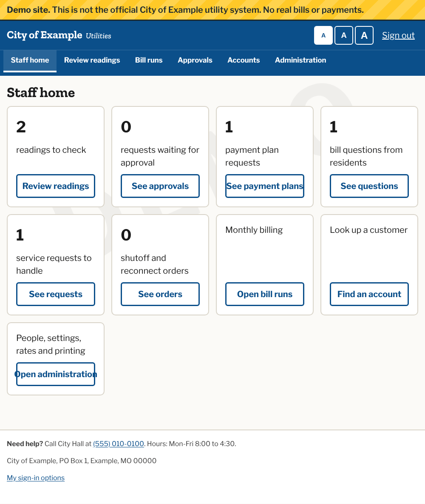

### Review readings
1. **Review readings** says "Accept a reading if it looks right. Flagged ones are listed first." Each entry shows
   "Water at 12 Elm St", **! Check this** when flagged, "Account 1001, Jane Doe. Meter 44512, read November 3,
   2026", "Last: 14500 → Now: 14920", and the reader's note.
2. Press **Accept** or **Reject**. A reading lower than the last one shows an extra box "Real amount used (needed
   because it is lower than last time)"; accepting without it says "This reading is lower than the last one. Type
   the real amount used (for a rolled-over or replaced meter), or reject it." A rejected reading goes back to the
   field list marked "! Needs a look". The clerk who took a reading cannot review it. When the list is empty:
   "✓ Nothing to check. All readings are done."

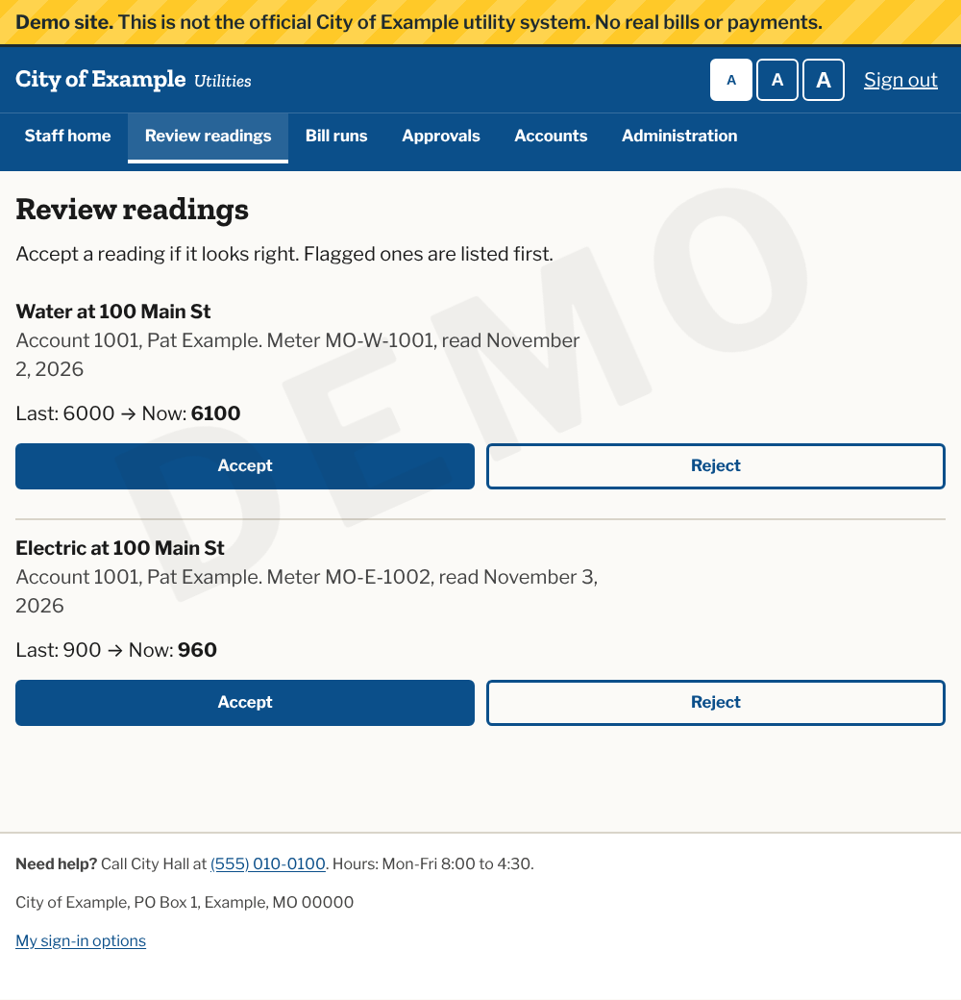

### Monthly billing (the bill run)
1. **Bill runs**: the card **Start a new bill run** has "First day billed" and "Last day billed", filled in with last
   month. Press **Start bill run**. The run opens, headed with its dates, marked **Not calculated**, with "Due date:
   November 15, 2026" (the city's days-until-due from today).
2. Press **Calculate bills**. The run prices every active account from accepted readings and the rates in force on
   the last day billed, adds flat charges and one-time charges, applies sales tax, and reports "212 bills
   calculated." or "212 bills made. 2 things need a look:" followed by lines such as "Account 1001: Water - no
   accepted meter reading" or "no rate set". Nothing is on any account yet. The status becomes **Ready for
   approval**.
3. The table lists every bill with account, name and total; **See the lines** under each name opens its charges.
   Fix readings, rates or accounts and press **Calculate again** as often as needed.
4. The yellow note says "A different person with the Approver role must approve this run. You can't approve a run
   you started." Once an approver approves, the status reads **✓ Approved and sent to accounts** and the bills are
   on every account.
5. After approval the clerk sees:
   - **Email bills to paperless customers**: "Sent 40 emails for 38 bills." or "Nothing to send. Every paperless
     bill has already been emailed." A failure says "N could not be sent. Press the button again to retry those."
     Pressing twice never sends a bill twice.
   - **Print**: choose a "Bill paper" layout and press **Open bills (PDF)**; choose an "Envelope" layout and press
     **Open envelopes (PDF)**. Each opens in a new tab ready to print. Paperless customers are left out of the
     envelope run. If no layouts exist yet: "To print, an administrator first sets up the paper and envelope
     sizes."
   The list on **Bill runs** shows every run with its status; "Cancelled" runs stay in the list.

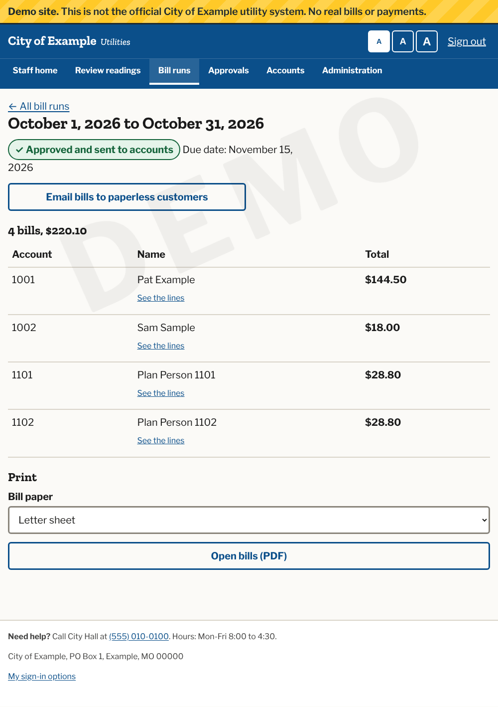

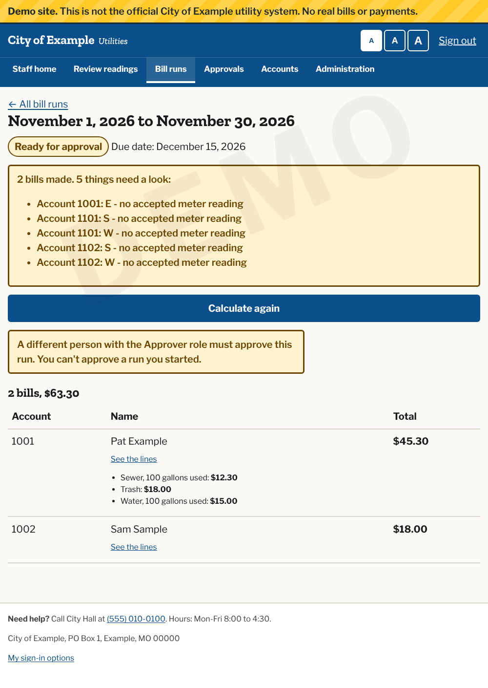

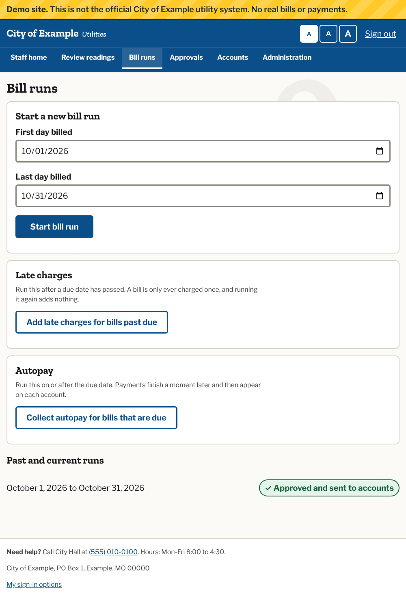

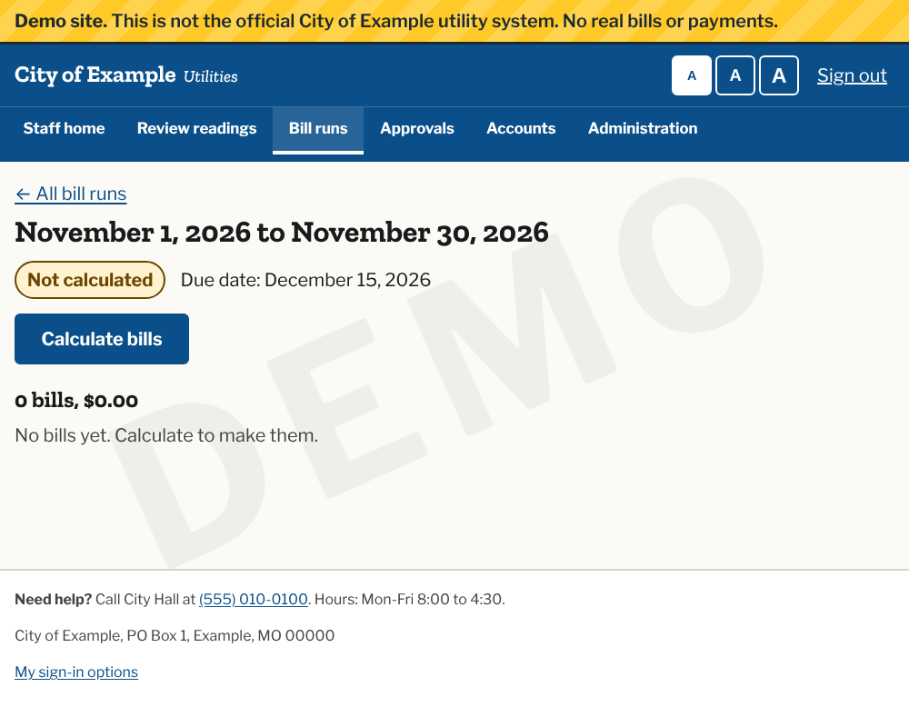

### Late charges
- On **Bill runs**, the card **Late charges**: "Run this after a due date has passed. A bill is only ever charged
  once, and running it again adds nothing." Press **Add late charges for bills past due**; the confirmation says
  "Every bill that is past its due date and still unpaid gets the city's late charge, once. Bills on a payment plan
  the customer is keeping up with are skipped." Result: "Added 14 late charges ($61.20). 2 skipped for payment
  plans." The charge is the city's percentage of what is still unpaid on the bill, rounded up to the cent. A date
  that has not come yet is refused.

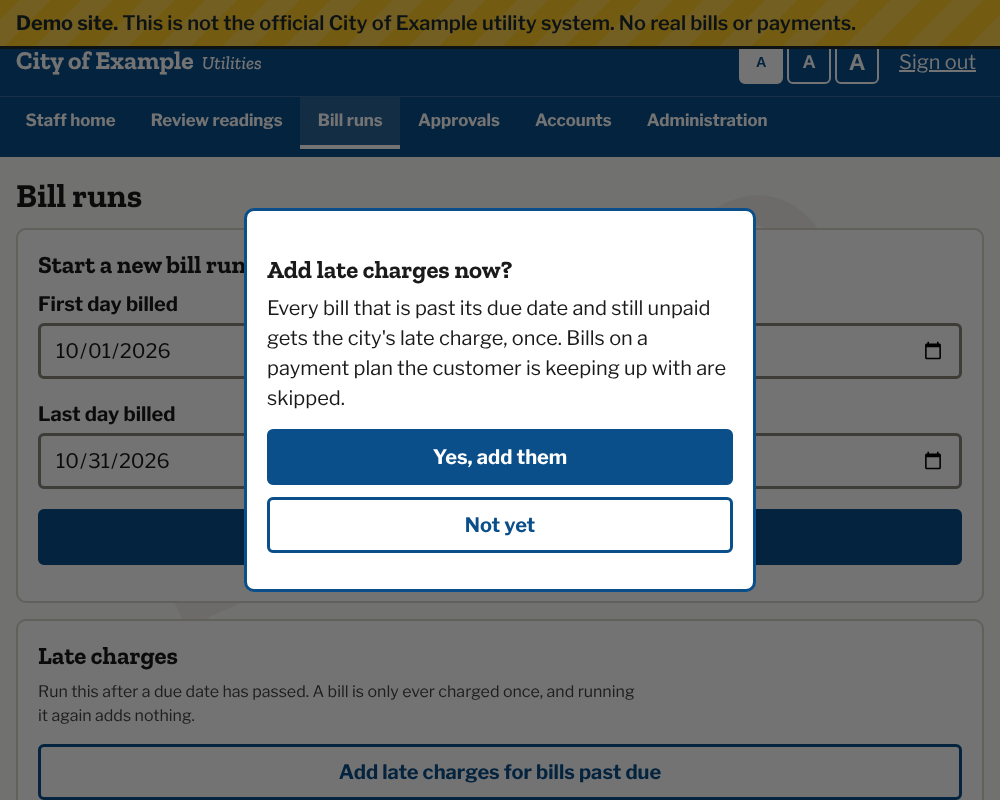

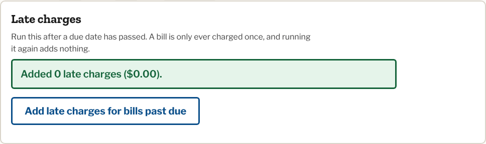

### Shutoffs and reconnects
1. From Staff home, **See orders** opens **Shutoffs and reconnects**. The card **Past due and past the notice
   period** lists accounts owing past the due date plus the city's notice days, with the overdue amount; an account
   on a plan says "(on a payment plan; plan amount not counted)". Press **Order shutoff**: "A field worker will see
   the address and shut off service. Please be sure the customer has had their notice." **Yes, send the order**.
   An account with an order already waiting shows "Shutoff already ordered" instead of a button.
2. **Open orders** lists what the field crew has, with **Cancel this order**. **Service is off** lists completed
   shutoffs with **Order reconnect**, which is refused while anything is still owed. **Finished orders** folds out
   the last 30 with the crew's notes.

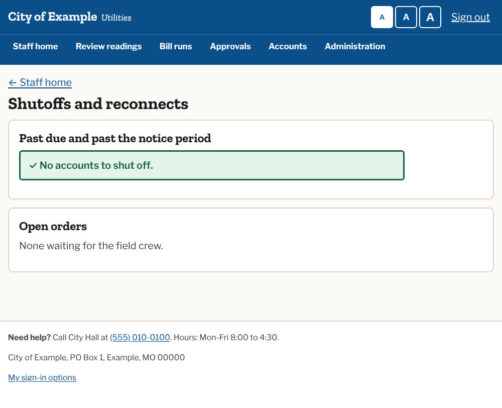

### Collect autopay
- On **Bill runs**, the card **Autopay**: "Run this on or after the due date. Payments finish a moment later and
  then appear on each account." **Collect autopay for bills that are due** asks for a safety check, then: "Started
  12 payments. 1 could not be collected and those customers were emailed. 3 skipped because nothing is owed." A
  nightly job can do the same thing without anyone pressing the button.

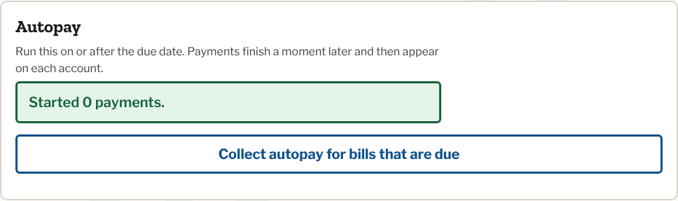

### Accounts
- **Accounts** has "Find a customer" ("Type a name, address or account number"); results show name, address and
  number and open the account.
- **Add a new account** folds out: account number, name, service address, and a checkbox per city service with
  "How many" for flat ones (two security lights). After **Add account**: "Account 1002 added. Print this link code
  on the first bill. It is shown only now:" with the code in large type and **Open the account**.
- The account page is headed with the name, "12 Elm St - Account 1001", a **Balance** card, a row of buttons, then
  the payment plan card if there is one, **Services and meters**, **Bills** (period, due, amount, Paid / Partly,
  $12.00 left / Not paid) and **History** (date, what, amount, with memos).
- Buttons a clerk has:
  - **Ask for an adjustment**: "Amount in dollars" ("Use a minus sign to lower the bill, like -25.00") and "Reason"
    ("A different person must approve this"). **Send for approval** → "Sent. It will appear on the account after a
    different person approves it."
  - **Refund a credit** (only when the balance is a credit): "This customer has a credit of $30.00. A different
    person must approve the refund before it is posted." Amount, and "Reason and how it will be paid back". More
    than the credit: "That is more than the credit on the account."
  - **Add a charge**: "Short code" (up to 6, like WF), "What it is for", amount. **Add charge** → "Added. It will be
    on the next bill." or, above the approval limit (or when small credits from the same person add up past it),
    "That amount is large, so it was sent for approval first."
  - **Make a new link code**: "The old code will stop working. The new code is shown once. Print it on the next
    bill or give it to the customer." Safety check, then the code in large type.
  - **Set up a payment plan** (when at least $2.00 is owed and no plan is waiting or running): "For a customer who
    calls or comes in. The plan covers what they owe now ($240.00). A person who can approve payment plans must
    approve it, and it cannot be you." Number of payments (2 to 24), "First payment due", "Why they need more
    time". The card then shows **Waiting for approval** with **Withdraw this request**.
  - On a running plan the card shows "On track. Paid $80.00 of $240.00." or "Behind. Paid $0.00 of $80.00 due so
    far.", the reason, the schedule, and **End this plan** ("Late charges and the shutoff list will treat the
    account normally again.").
- **Services and meters**: each service with "Flat charge", "Metered" or "Stopped", a "How many" box with **Save**
  for flat services, and **Stop Water** / **Start Water again**. **Add a service** picks from the city's services
  not yet on the account. Each meter shows its number and location with **Turn this meter off** / **on** and
  **Fix a wrong reading**. **Add a meter** takes the service (only ones the account has), meter number and "Where
  on the property (optional)".
- **Fix a wrong reading** (the 500-extra-units case):
  1. The card **Fix a wrong reading: Water meter 44512** says "Pick the reading that was wrong." and lists each
     accepted reading: "15,000 on October 1, 2026", "1,000 used, already billed" (or "not billed yet"). Press
     **This one is wrong**. A reading with a fix already waiting shows "Fix waiting for approval" instead.
  2. The form **Reading of 15,000 on October 1, 2026** asks "The right meter number" and "What went wrong" ("For
     example: 'Reader wrote 15000, meter shows 14500.'"). Press **Show what changes**: "Reading: 15,000 → 14,500.
     Usage from this reading: 1,000 → 500 units. The customer gets a credit of $3.25." with "Bill ending October 31, 2026: $12.50 for these charges,
     should be $9.25." and "A different person must approve this. The reading is changed when they do." The next
     reading's usage goes up by the same 500 so the meter still adds up. A reading not billed yet, or billed only in
     a run that is not approved, shows "Not billed yet, so no money changes. The next bill will use the right
     number."
  3. **Send the fix** → "Sent for approval. When it is approved the reading is fixed and a credit of $3.25 goes on
     the account." or, with no money involved, "Fixed. The next bill will use the right number." (recalculate the
     run afterwards). The same number as already saved: "That is the same number that is already saved." A number
     that would make usage negative is refused with an explanation. Only an accepted reading can be fixed.
- The clerk does not take counter payments; that button belongs to the cashier.

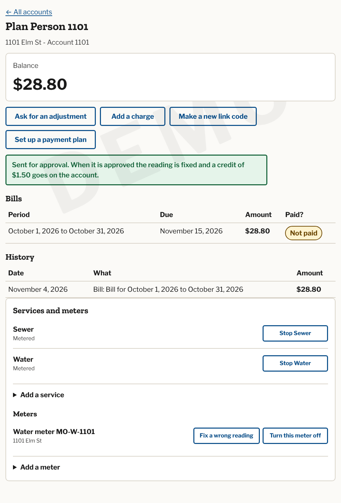

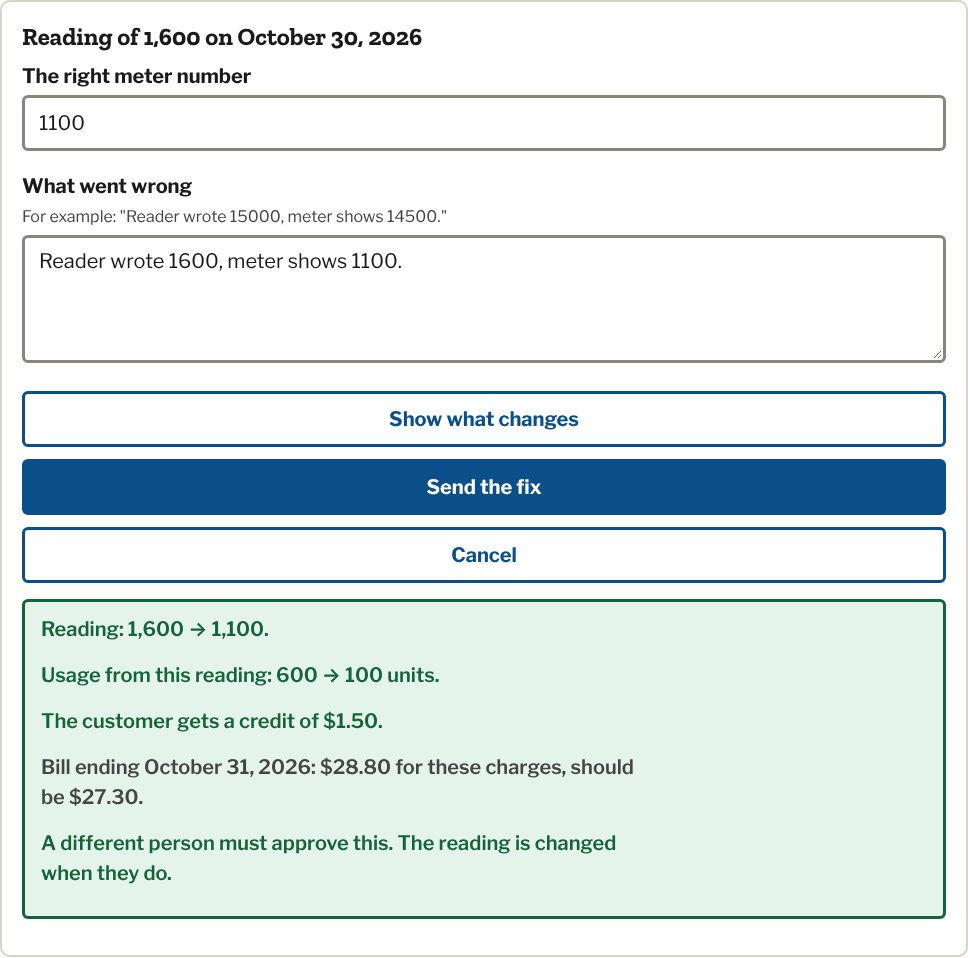

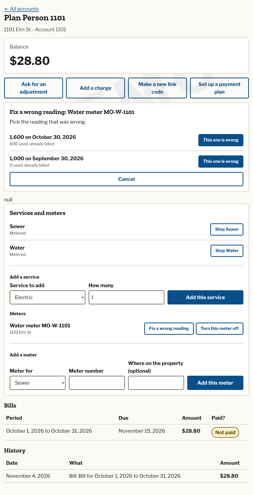

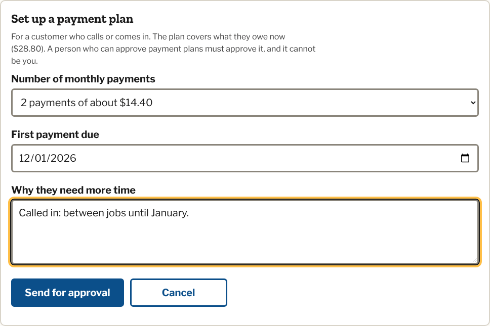

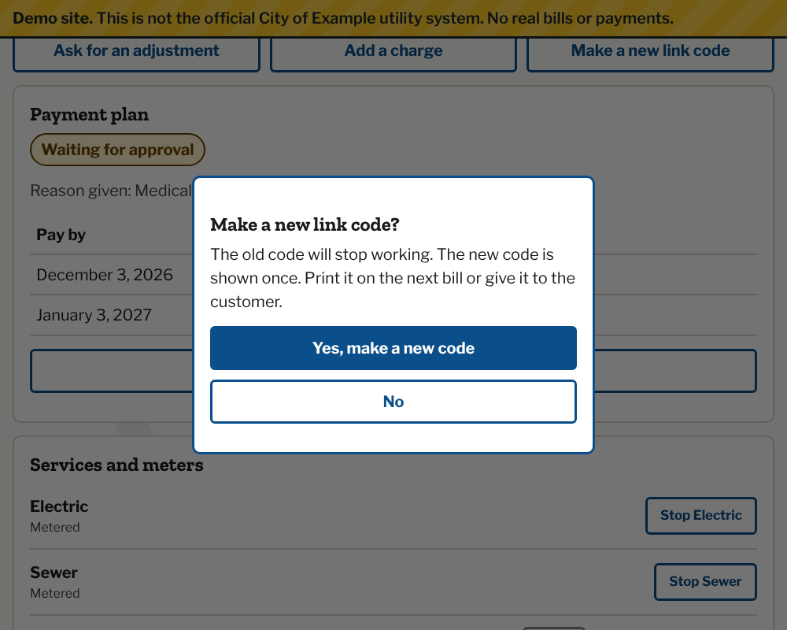

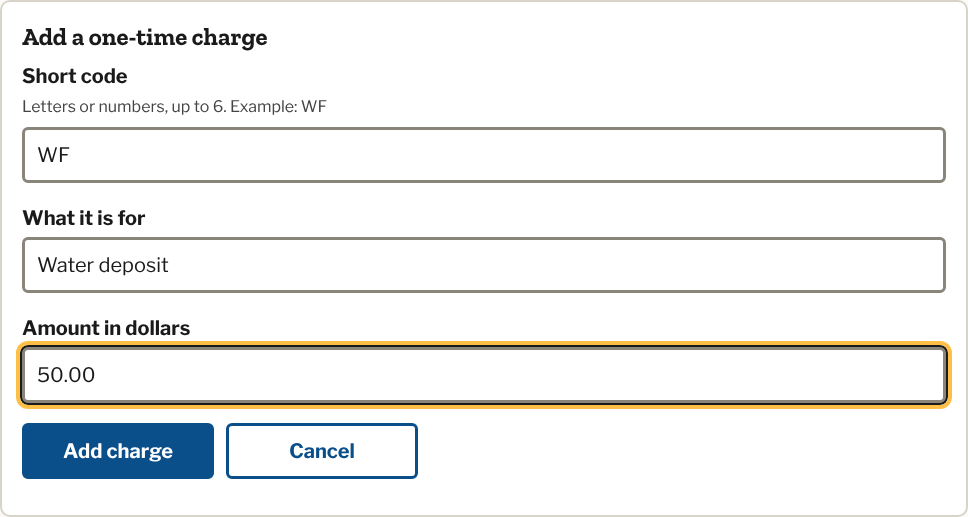

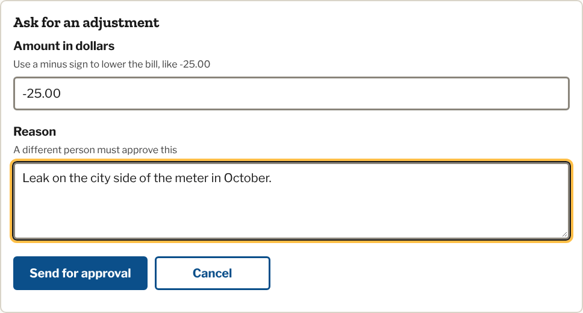

### Bill questions and service requests
- **Bill questions** (from Staff home, **See questions**): each shows "Resident says: ..." and the date, a box "Your
  answer to the resident", and **Mark fixed or explained** or **Bill is correct**. The answer is saved to the bill
  question. Fix the bill itself with an adjustment or a reading fix.
- **Service requests**: tabs **Waiting**, **Done**, **Declined**. Each card is headed "New service: Pat Lee" or
  "Move out: Jane Doe, account 1001", with a status (New, Scheduled, ✓ Done, Declined, or **! Urgent** for a leak),
  the facts (address, date wanted, forwarding address, phone, note), and a hint on what to do next (for a move
  out: "Schedule the final read. After the final bill is made and mailed to the forwarding address, mark this
  done."). Type a "Note to the resident (they will see it)" and press **Mark scheduled**, **Mark done** or
  **Cannot do this**. The resident sees the status and the note on their Service requests page.

### Administration (clerk's part)
The clerk's **Administration** page has **Services and rates** (view only; the clerk can see the current rate and
what is coming) and **Printing** (print test pages; only an administrator changes layouts).

### A billing clerk must NOT be able to
- Approve anything: a bill run, an adjustment, a refund, a reading fix or a payment plan. The buttons are not
  shown, and the server answers "You don't have permission to do that."
- Review a reading they submitted.
- Record a counter payment, change people or roles, change city settings or rates, or read the activity log.
- Add late charges for a future date, or attach meters, services or roles to another city's records.

---

## Cashier

**Tabs:** Staff home, Approvals, Accounts.

### Take a payment at the counter
1. **Accounts**, find the customer, open the account. The page shows the **Balance**, the **Bills** table with each
   bill's Paid / Partly / Not paid, and the **History**.
2. Press **Take a payment**: "Amount in dollars" ("For example 45.00"), "Paid by" (Cash / Check), "Check number (if
   a check)". **Record payment**. The payment is on the account at once and shows in History as "Payment" with the
   method and check number. A bad amount: "Please type an amount like 45.00."
3. If something is wrong with the bill, **Ask for an adjustment** or **Refund a credit** work the same as for a
   clerk: a different person approves.
4. **Approvals** is visible so the cashier can see what is waiting and tell the customer, but it has no buttons.
   Staff home shows "N requests waiting for approval" and "Look up a customer".

### A cashier must NOT be able to
- Approve or decline anything, add charges, start bill runs, change settings, see the activity log or people, or
  change services and meters.
- See draft bills from a run that is not approved yet.

---

## Customer service

**Tabs:** Staff home, Approvals, Accounts.

Everything a cashier can see, plus the account changes a clerk can make: services and quantities, meters (adding
and turning off, not fixing readings), link codes, adjustments, one-time charges, refunds, setting up and ending
payment plans. Staff home also shows "N bill questions from residents", "N service requests to handle" and "N
shutoff and reconnect orders" (view only), and customer service works the **Bill questions** and **Service
requests** queues exactly as described for the clerk.

Customer service cannot take counter payments, review readings, run billing, add late charges, order shutoffs,
fix readings or decide anything.

---

## Approver

**Tabs:** Staff home, Bill runs, Approvals, Payment plans, Accounts.

Staff home shows "N requests waiting for approval", "N payment plan requests", "Monthly billing" and "Look up a
customer". Every approval asks for the safety check first (once per window).

### Approve a bill run
- **Bill runs** lists each run with its status. Open one marked **Ready for approval**: the heading shows the
  dates, "Due date", and "212 bills, $18,240.50". **See the lines** under any name shows that bill's charges.
- Press **Approve 212 bills ($18,240.50)**. The confirmation: "212 bills totaling $18,240.50 will be added to
  customer accounts. This cannot be undone, only corrected." **Yes, approve**. Safety check. Then "Approved. Bills
  are now on customer accounts." The person who started the run sees no button, only the note that a different
  person must approve.

### Decide adjustments, charges, refunds and reading fixes
- **Approvals** says "Requests from staff to change a customer account. The person who asked cannot approve their
  own request." Each entry: "Adjustment on account 1001" (or Charge, or Refund), the amount (credits in green),
  the name, and "Reason: ...". A reading fix arrives as an adjustment whose reason starts "Corrected meter
  reading: meter 44512 was saved as 15000, the right number is 14500 (500 fewer units)."
- **Approve** or **Decline**. Above the city's approval limit a second, different approver must also approve: the
  first sees "First approval recorded. A second approver is needed." and the entry stays with the yellow note "One
  approver has signed. A different approver must give the second approval."; the same person pressing again is
  refused.
- Approving posts the money to the account and, for a reading fix, changes the reading and the next reading's
  usage at the same moment. If the readings changed in between, the approval is refused with "The readings changed
  after this fix was asked for. Decline it and ask again." A refund is refused if the customer no longer has that
  much credit. Nobody can decide a request they made.
- When nothing is waiting: "✓ Nothing waiting."

### Decide payment plans
- **Payment plans**: "Customers who asked to pay what they owe in monthly parts. While a customer keeps up with an
  approved plan, the bills in it get no late charge and the account stays off the shutoff list."
- Each request: the customer's name and account (a link to the account), the plan total, "12 Elm St. Asked
  November 3, 2026 by the customer. Owes $240.00 today.", "Reason: ...", and the proposed schedule.
- The approver can change "Payments" (2 to 24) and "First payment due" (must be within 3 months; a far-off date is
  refused), write a "Note to the customer" ("Needed if you decline. The customer sees it."), then **Approve** or
  **Decline**. The page confirms "Plan approved. The customer was emailed." or "Request declined. The customer was
  emailed." A request the approver made themselves (as staff for a customer) shows "You asked for this one, so a
  different person must decide it."

### Reverse a mistaken ledger entry
- On an account's **History**, every entry that has not been reversed has a **Reverse** button (a payment typed on
  the wrong account, for example). The form **Reverse this entry: $45.00** says "A new entry for the opposite
  amount is added. The original stays in the history. This needs a safety check." and asks "Why". **Reverse it**.
  The original then shows "Reversed" and a new "Reversal" entry appears. An entry can be reversed only once;
  reversals themselves cannot be reversed.

### An approver must NOT be able to
- Start or calculate a bill run, take payments, add charges, change settings, people or rates, or read the
  activity log. The approver sees accounts but has none of the change buttons.
- Give the second approval to something they gave the first approval to, or approve their own request.

---

## City administrator

**Tabs:** Staff home, Bill runs, Approvals, Accounts, Administration.

Staff home shows the approvals, plans, requests and orders counts (view only), "Monthly billing", "Look up a
customer" and "People, settings, rates and printing". The administrator can look at any account, change services
and meters, make link codes and set up payment plans, but cannot take money, approve, or run billing.

**Administration** is a set of cards: People and roles, City settings, Colors, logo and demo mode, Updates,
Services and rates, Printing, Activity log.

### People and roles
- **People and roles**: "A person can have more than one role. Some combinations are not allowed on purpose, so the
  same person cannot both start and approve a payment change."
- **Add a staff member**: "Full name" and "Email address" ("They sign in with a code sent to this address. There is
  no password."). **Add this person** → "Pat Lee was added. Now choose what they can do."
- Each staff member is a card with their name, email, "(turned off)" when off, and the roles they hold. Under
  "What Pat can do" is a checkbox per role with a one-line description: City administrator ("Manages staff, rates
  and settings."), Billing clerk, Cashier, Meter reader, Approver ("Approves bill runs and bill changes. Cannot
  approve their own work."), Auditor ("Can look at everything. Cannot change anything."), Customer service. Ticking
  or unticking a box asks for the safety check and saves at once: "Approver added to Pat Lee." Every role change
  sends the email "A staff role was changed" to the other administrators.
- Your own card says "This is you. You cannot change your own roles."
- **Turn off Pat Lee**: "Pat Lee will be signed out and cannot sign in again. Their past work stays in the record."
  **Yes, turn them off**.
- A city administrator may give any staff role except site administrator, including city administrator, so the city
  is never down to one person. The only city administrator cannot be removed or turned off; add another first (the
  attempt is refused with a plain message).

### City settings
- One form: City Hall phone number, Office hours ("Shown at the bottom of every page"), City return address
  ("Printed on bills and envelopes"), Where to mail payments, Days until a bill is due, Late charge (percent),
  Days after the due date before a shutoff can be listed, Extra approval above this amount (dollars) ("Above this,
  one-time charges need an approver, and bill changes need two different approvers"), Sales tax (percent), Flag a
  meter reading that uses this many times the last use, Minutes a safety check stays good (1 to 30).
- **Fees for paying online**: a plain explanation, a yellow warning about card-company rules (credit-only fees up to
  3%, Visa notice, the Service Fee Program for all-card fees, "Please check with Stripe and the city attorney
  first"), then No card fee / Fee on credit cards only / Fee on all cards; Stripe's percentage and per-payment
  cents; a cap "never more than this percent of the bill"; "Add a fee to bank account payments" with its
  percentage and largest fee. A live example line reads "Example: a $100.00 credit card payment costs the customer
  $103.00." as the numbers change. The fee charged to a customer is grossed up so the city nets the full bill.
- **Apple Pay and Google Pay**: Google Pay shows up on its own; **Turn on Apple Pay for this web address** asks
  Stripe to check the site's address and answers "✓ Apple Pay is on for utilities.city.gov" or says what Stripe
  could not check. Card numbers still go straight from the phone to Stripe, so the city's PCI position is unchanged.
- **Save settings** asks for the safety check, then "✓ Settings saved." A bad number says which field: "Please check
  'Safety check minutes'. It needs a number of at least 1."
- Only a city administrator can change the money fields (due days, late charge, shutoff days, approval limit, tax,
  fees); for anyone else they are greyed out with "Late charges, due dates, fees and approval limits can only be
  changed by a city administrator."

### Services and rates
- Each service (Water, Sewer, Trash, Electric, and any the city adds) is a card with **✓ On** or **Off**, "Current
  rate:" in words ("$15.00 covers the first 2,000 gallons; then $6.50 per 1,000 gallons; minimum $15.00. Since
  January 1, 2026"), any "Coming:" rate, and **Past rates** folded away. A service with no rate shows "No rate set
  yet, so bills cannot include this service."
- **Set a new rate**: "Old rates are never changed. The new rate starts on the date you pick, and bills before that
  date keep the old one." Name on the bill, Starts on, "How is it priced?" (One flat price / By how much is used).
  Flat: "Amount each month". Metered: Base charge, Units included in the base charge, one or more price steps
  ("Up to how many units?" and "Price per 1,000 units"; leave the last one's "up to" empty for everything after;
  **Add another step**), Smallest monthly bill, a fuel or supply adjustment and its name on the bill, "What is
  counted" (gallons, therms, kWh), a multiplier for the reading, "Bill each meter on its own line", and "Charge
  based on use of another service" (sewer on water). "Sales tax applies". **Save this rate** asks for the safety
  check. Each mistake is named: "Step 2: 'up to' must be a number bigger than the one before it."
- **Turn off Water** / **Turn on Water**: "New bill runs will leave this service off. Old bills do not change."
  Safety check.

### Printing
- **Printing**: "Tell utilities the size of the paper and envelopes you actually have. Each layout is yours to change
  at any time." **Bill layouts** and **Envelope layouts** each list the layouts with their size ("8.5 by 11
  inches"), **Print a test page** (opens a PDF filled with sample data) and **Change**. **Add a bill layout** /
  **Add an envelope layout** opens a new layout already filled in: a city header, a boxed "Your account" block, a
  shaded "Amount due" box, a divider, the charges table, a dashed "Cut here" line and a boxed payment stub; the
  envelope has the return address and the recipient in the window position.
- The editor: name, "Measured in" (inches, millimeters, points), paper width and height, "Print corner marks", and
  a numbered list of items. Each item picks "What prints here" (city name, return address, where to mail payments,
  office hours, phone, customer name, account number, service or mailing address, billing period, due date, total
  due, the list of charges, fixed text, a box, a line), with "Words printed before it" (such as "Due: "), distance
  from the left and top, width, text size, alignment, bold, a height for the charges list and boxes ("it stops here
  so it never prints over what is below it"), a heading for a box or line, and "Gray inside the box, or a dashed
  'cut here' line". **Add an item**, **Remove this item**, **Save layout** ("Saved 'Window envelope'. Use 'Print a
  test page' to check it."), **Delete this layout**. An empty layout, a box without a size, or a text size outside 4
  to 72 is refused with the item number named.
- Long charge lists never spill: the table stops at its height and prints "...and 3 more charges". Addresses that do
  not fit are trimmed, so every envelope stays lined up.

### Colors, logo and demo mode
- **City colors**: Top bar and headings, Buttons, Stripe under the top bar (or "No stripe"). "The words on the top
  bar and on buttons are white, so those two colors must be dark. Colors that are too light are not accepted."
  **Save the colors** / **Go back to the standard colors** → "✓ Colors saved. Reload the page to see it."
- **City logo**: "A PNG or JPEG picture under 300 KB. It shows in the top bar of every page." **Save the logo** /
  **Remove the logo**.
- **Demo mode**: "While this is on, every page shows a yellow bar saying this is a demo, a faint DEMO sits behind
  the pages, search engines are told to stay away, and no real payments can be made. Turn it off when the city is
  ready to use this for real."
- All three save behind the safety check.

### Updates
- **Updates** reports "✓ Up to date. This city is running 1.4.0." or "A newer version is ready: 1.5.0. This city is
  running 1.4.0." with a link to what is new, and "Whoever hosts this program installs it." The form "Where
  updates come from" has "Look for new versions" and the GitHub address (only github.com is accepted).

### A city administrator must NOT be able to
- Approve or decline anything, take payments, start bill runs, review readings or fix readings.
- Change their own roles, give the site-administrator role, or remove the last city administrator.

---

## Site administrator (the person who runs the server)

**Tabs:** Staff home, Administration.

- Staff home has one card, "People, settings, rates and printing". Administration shows People and roles, City
  settings, Colors, logo and demo mode, and Updates.
- Names the first city administrator when a city is set up (the only role a site administrator can give). After
  that, only a city administrator adds, removes or turns off a city administrator.
- Can change the non-money settings (phone, hours, addresses, high-use flag, safety-check minutes), colors, logo,
  demo mode and the update source. The money fields are greyed out.
- May turn a city service on or off (safety check), but never set a rate.
- Must NOT be able to see any customer account, balance, bill, payment, approval, plan or work order (every such
  address answers "You don't have permission to do that."), or change any money setting or rate. Role changes they
  make are emailed to the city administrators.

---

## Auditor

**Tabs:** Staff home, Bill runs, Approvals, Accounts, Administration.

- Reads everything about money and people; changes nothing. Staff home shows the approvals count, "Monthly
  billing", "Look up a customer" and "People, settings, rates and printing". Bill runs, approvals and every account
  (balance, bills, history, services, meters, plans) open read-only, with no buttons.
- Administration shows **People and roles** (read only) and **Activity log**: "Every change to money, people, rates
  and settings is written here. Entries cannot be edited or deleted." A table of When, Who, What ("Approved a bill
  run", "Took a payment at the counter", "Gave a role", "Passed a safety check") and plain details ("amount:
  $45.00, method: cash"). **Check that the record is untouched** answers "✓ The record is complete. Nothing has been
  changed or removed." or "The record was changed at entry number 318. Tell your site administrator right away."
- Must NOT be able to write anything: every save, approve, pay, charge or setting answers "You don't have
  permission to do that."

---

## Every email the system sends

| Email | Who gets it | When |
| --- | --- | --- |
| "City of Osceola utilities: your code" | Anyone signing in, or passing a safety check | On request; the code works for 10 minutes |
| "Your City of Osceola utility bill" | Paperless customers | When a clerk presses Email bills after a run is approved; once per bill |
| "Your payment plan was approved" / "About your payment plan request" | The customer | When an approver decides; the decline note is included |
| "Your autopay could not be collected" | The customer | When an autopay charge fails; the city does not retry |
| "A staff role was changed" | The other administrators | On every role grant or removal |
| Stripe's receipt | The customer | After an online payment, from Stripe |

Bill questions, service requests, approvals and shutoffs are not emailed; their status shows on screen.

---

## The money rules, in one place

- Every bill, payment, charge, adjustment, late charge, refund and reversal is a ledger entry. Entries are never
  edited or deleted; a mistake is fixed by a reversal entry.
- Bills become money only when a second person approves the run. Adjustments and refunds need a different person
  to approve, and above the limit a third. Payment plans and reading fixes go through the same approvals.
- Late charges apply once per bill, only after the due date, never to a bill in a plan being kept up, never for a
  date that has not come.
- Online payments credit only the bill amount; a pass-through fee stays on the payment record. Stripe's own
  records are the source of truth: the app asks Stripe before marking anything paid, one payment can be charged
  once, and events that change nothing are not remembered so they can be sent again.
- Card and bank numbers never reach the server. Autopay keeps only an opaque reference and a label.
- Nobody sees more than their job needs: the field crew sees addresses and meters, the site administrator sees no
  customers, the auditor sees everything and changes nothing.

---

## Manual test checklist (run after any update, on the demo first)

Use the test users `role_1@…` and `role_2@…`. Expected result in brackets.

**Sign-in**
- [ ] Wrong code [plain message]; sixth wrong code [refused]; code reused [refused]; fourth code request in 10
      minutes [Too many tries].
- [ ] Sign out, press Back [sign-in page, not the old screen].
- [ ] Add a passkey, sign out, sign in with it; remove it [emailed code still works].

**Resident**
- [ ] Link with a wrong code x5 [locked for an hour]; link with the right code [account appears on Your utility bills].
- [ ] Pay part of a bill by debit card [no fee, bill shows Partly paid, memo on Recent activity].
- [ ] Credit card [fee line in Check your payment, total matches Stripe, only the bill amount on the account].
- [ ] Decline card then good card on the same page [one payment, no leftover fee].
- [ ] Bank account [Your bank payment has started; posts after Stripe confirms].
- [ ] Ask for a plan; take it back; ask again [Waiting for the city each time].
- [ ] Something looks wrong on a bill [thank-you message; second attempt on the same bill refused].
- [ ] Stop paper bills [emailed on the next run, left out of envelopes].
- [ ] Try another account's id in the address bar [We couldn't find that].

**Meter reader**
- [ ] Reading list shows no names or balances. Lower reading asks twice. Offline reading sends later, once.
- [ ] Complete a shutoff order with a note [order gone, note visible to the clerk under Finished orders].

**Clerk**
- [ ] Accept a flagged reading with usage typed in. Cannot accept own reading.
- [ ] Start, calculate, recalculate a run; warnings name the account and reason; cannot approve it.
- [ ] Add late charges today [once]; again [adds nothing]; for next month [refused].
- [ ] Shutoff list respects notice period and plans. Order shutoff; second order refused; reconnect refused until paid.
- [ ] Print bills and envelopes [nothing blank, boxes and lines print, town line on envelopes, total matches];
      email bills twice [second sends 0].
- [ ] Fix a reading: preview amount is right, next reading's usage moves the other way; cannot approve own fix.

**Cashier**
- [ ] Counter cash and check post at once with the check number in the memo. Approve, charge, run, settings, log
      [all refused].

**Customer service**
- [ ] Answer a bill question and a service request; resident sees the status and the note. Refund larger than
      credit [refused].

**Approver**
- [ ] Every approval asks for the emailed code once per window. Cannot approve own request. Second approver needed
      above the limit; same approver twice [refused].
- [ ] Approve a plan with a changed schedule [customer emailed]; 2099 start date [refused]; decline with a note
      [customer sees it].
- [ ] Reverse a ledger entry once; second reversal [refused]; original shows Reversed.

**City administrator**
- [ ] Add a person, give a role [other admins emailed]; cannot change own roles; cannot turn off the last city
      administrator.
- [ ] Save settings [safety check]; safety-check minutes 100 [refused]. Fee example line updates. Add a rate with a
      unit [shows on the bill as "4,200 gallons used"]. Empty print layout [refused]; test page prints boxes.

**Site administrator**
- [ ] Any account page [refused]; money setting [refused]; non-money setting [saved].

**Auditor**
- [ ] Activity log opens and the check says intact. Any write [refused].
